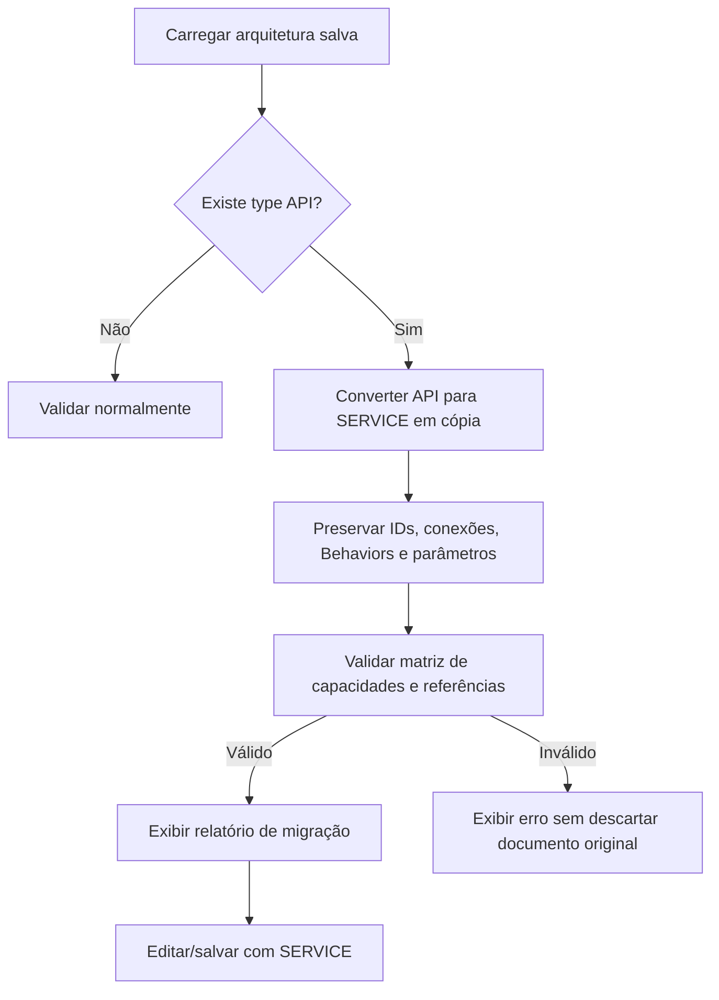

# MIG-V5-001 — Migração do componente API para SERVICE

> **Status:** decisão aprovada para a v0.5. Plano de migração; ainda não implementado no backend/frontend. Referências: [mvp-v0.5](../requirements/mvp-v0.5.md), [ADR-V5-001](../architecture/ADR-V5-001.md), [API-V5-001](API-V5-001.md).

## Decisão

Na v0.5, `SERVICE` é o único componente genérico de processamento. `API` não é mais tipo criável, item da paleta ou tipo de nó emitido ao salvar uma arquitetura nova: uma API é uma **interface oferecida por um Service**, definida pela(s) conexão(ões) e configuração de operação.

O tipo `API` permanece temporariamente no `Component.oneOf` do rascunho OpenAPI, com `deprecated: true`, **somente como representação de entrada histórica** da série v0.1–v0.4.1. Isso não implica uma segunda implementação ativa na v0.5. No futuro, quando a migração estiver validada, poderá ser removido do contrato principal.

## Regras normativas de importação

1. Detectar cada nó `{type: "API"}` no documento importado; manter `id` e `displayName`.
2. Converter `type: "API"` para `type: "SERVICE"` explicitamente durante a importação; apresentar mensagem com quantidade e identificadores convertidos.
3. Preservar `behaviors`, `actions`, dependências, processamento pré/pós, parâmetros de integração, timeouts, conexões dirigidas, IDs e perfis já definidos.
4. Revalidar capacidades do Service, direcionamento e referências de todas as conexões/Actions. Alterações necessárias ao contrato devem ser explícitas e rastreáveis.
5. Processar e salvar novas arquiteturas com `SERVICE`, jamais emitir `type: API`.
6. Em caso de ambiguidade/invalidade, emitir erro de migração com caminho do campo; **não** descartar configuração nem criar conexões substitutas silenciosamente.
7. Preservar compatibilidade de simulação `UnifiedScenario` e caminhos legados enquanto houver importação, sem criar endpoint `/api/v5`.
8. `apiProcessingOverride` é nome histórico de campo; mantê-lo no wire format por compatibilidade e aceitar seu uso em destinatário SERVICE onde semanticamente apropriado, sem renomeação abrupta.

## Pseudofluxo

## Critérios de aceitação

- **MIG-01:** importação de arquivo v0.4.1 com dois componentes `API` produz dois `SERVICE` com mesmos IDs e Behaviors.
- **MIG-02:** `Client → API → Broker → API → Database` vira `Client → Service → Broker → Service → Database` sem mudanças de conexões nem gatilhos causais.
- **MIG-03:** simulação antes/depois da migração preserva operações, tempos e resultados equivalentes conforme semântica do motor.
- **MIG-04:** frontend não oferece `API` na paleta e nunca serializa `type: API` numa arquitetura nova.
- **MIG-05:** validações não interpretam `API` como novo tipo funcional. A tolerância existe somente para importação/compatibilidade com exemplos históricos.
- **MIG-06:** migração não altera `API_GATEWAY`, propriedades de `DATABASE` ou outros tipos cujo nome contém API.
- **MIG-07:** erro de importação inválida mantém documento original íntegro, sem gravação parcial.

## Limite

Este documento especifica uma migração. Nenhum código de importação, schema Java ou editor React foi alterado nesta branch; a funcionalidade deve ser implementada e testada nas tarefas de backend/frontend da v0.5.
