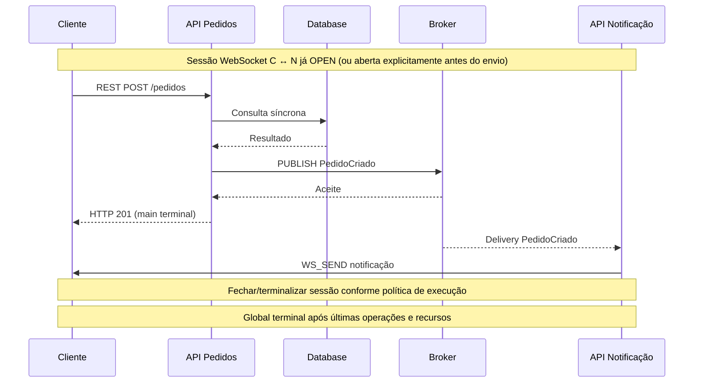

# ADR-V4.1-001 — Cenário unificado e comportamento causal dos componentes

> Status: **Proposto para revisão**. Data: 2026-11-04. Não implica mudança de código.
> Referências: [requisitos v0.4.1](../requirements/mvp-v0.4.1.md), [DM-V4-001](DM-V4-001.md), [VAL-V4-001](VAL-V4-001.md), [API-V4-002](../api/API-V4-002.md).

## Contexto

O cenário v0.4 discrimina toda a execução por `scenario.kind` (`REQUEST_RESPONSE`, `WEBSOCKET_SESSION`, `MESSAGE_PUBLISH`). Isso descreve a entrada, mas pode impor uma restrição artificial ao comportamento completo da arquitetura. Precisamos que a mesma operação principal cause REST, consumo em Broker e notificações WebSocket numa execução observável.

## Decisão proposta

1. **Um cenário de execução, vários perfis de comunicação.** Cenário contém ponto de entrada, ação/evento inicial e parâmetros; não contém um perfil global obrigatório. A conexão determina o perfil, e o componente determina ações possíveis.
2. **Ações locais e derivadas.** Um componente reage a um gatilho de entrada por um plano finito de ações; ações são ordenadas por dependências explícitas. Não executar indiscriminadamente todas as arestas conectadas.
3. **Operação principal única.** Ao entrar, criar root operation e zero ou mais operações derivadas, preservando `executionId`, `operationId`, `parentOperationId` e, quando relevante, `correlationId`, `messageId`, `sessionId`, `connectionId` e `profile`.
4. **Semântica síncrona/assíncrona não depende de cenário global.** Chamadas síncronas aguardam resposta/terminalidade; publicações independentes prosseguem para entregas; envio WebSocket depende de sessão aberta.
5. **Dois marcos de conclusão.** `mainStatus` acompanha a operação de entrada. `globalStatus` consolida todas as operações causadas e recursos relevantes, inclusive erro parcial. Sessões persistentes exigem política explícita de fechamento ou horizonte finito. Nunca prender a execução indefinidamente.
6. **Reutilizar motor existente.** Aproveitar `ExecutionPlan`, scheduler virtual, dispatcher, trace e resultados onde eles suportarem a semântica; ampliar contratos minimamente.
7. **Preservar /api/v1 e UX.** Alterar discriminador apenas após planejar compatibilidade. Editor recebe entradas de configuração contextual, não editor de workflows complexo.

## Modelo conceitual — não é definição obrigatória de DTO Java

```text
Architecture
  components[]: Component { id, type, properties, behaviors[] }
  connections[]: Connection { id, sourceId, targetId, integration{kind,...}, latency }

ComponentBehavior
  trigger: REQUEST_RECEIVED | MESSAGE_CONSUMED | WS_MESSAGE_RECEIVED | SESSION_OPENED
  match: operação/caminho/fila/tópico/sessão conforme gatilho
  actions[]: BehaviorAction { id, kind, connectionRef?, dependencies[], properties }
  
BehaviorAction.kind (conceitual)
  PROCESS | CALL | PUBLISH | RESPOND | OPEN_SESSION | WS_SEND | CLOSE_SESSION | FORK | JOIN

SimulationScenario
  entry: { componentId, operationId?, connectionId?, initialEvent?, inputs? }
  executionOptions: { limites/reprodutibilidade }

Execution
  rootOperationId, operations[], messages[], sessions[], trace[], timeline[]
  mainStatus, globalStatus
```

Esses nomes são propostos: o contrato final deve reconciliá-los com `apiExecutions`, tipos anteriores e os componentes existentes, sem reclassificação silenciosa.

## Regras causais / validação

- `CALL`: exige conexão de requisição/resposta compatível. Pai aguarda resultado se houver dependência; falha propaga conforme política explícita da ação.
- `PUBLISH`: exige conexão ao Broker com Queue/Topic/MQTT. Aceite pelo Broker não equivale a processamento por consumidor.
- `MESSAGE_CONSUMED`: entrega do Broker ativa comportamento do consumidor, que pode chamar API, publicar outra mensagem ou enviar via WebSocket.
- `OPEN_SESSION`: conecta participantes compatíveis com WebSocket, gerando `sessionId`.
- `WS_SEND`: exige sessão `OPEN` correspondente e participante autorizado; destino não é escolhido implicitamente só porque existe uma aresta WebSocket.
- `CLOSE_SESSION`: torna sessão terminal; falha/timeout também encerra os recursos de maneira rastreável.
- `FORK/JOIN`: preservar ordenação determinística e conclusão finita; não permitir ciclos infinitos ou dependências ambíguas.
- Componentes desligados da cadeia causal de entrada permanecem inativos.
- Preferir validação antes da execução; erros descobertos em runtime devem ser eventos e resultados explícitos.
- A matriz de compatibilidade entre os tipos de componentes e dez perfis permanece a da v0.4, até ADR separado que a modifique.
- Evento com mesmo timestamp virtual utiliza desempate determinístico já estabelecido pelo scheduler.

## Sequência de referência (Mermaid)



O fluxo é semântico e não envia pacotes reais.

## Alternativas rejeitadas

1. **Três motores separados por cenário:** fragmenta correlação e impede fluxo misto natural.
2. **Deduzir fluxo de todas as arestas:** executa operações não solicitadas e cria explosão combinatória.
3. **Representar WebSocket como REST duplo:** perde sessão, bidirecionalidade e ciclo de vida.
4. **Editor de script/BPMN obrigatório:** alta complexidade de UX para o problema atual.

## Consequências e trade-offs

- (+) Mesma simulação passa por protocolos variados.
- (+) Conexões guardam seus perfis, evitando duplicar definição do protocolo no cenário.
- (+) Timeline causal única e testes reprodutíveis.
- (-) Necessário modelo de comportamento e migração de payloads antigos.
- (-) Sessões persistentes exigem regra explícita de término, mesmo com operação principal encerrada.
- (-) Mais combinações de validação; controlar tamanho/profundidade/tempo.

## Questões a fechar antes do backend

1. Esquema normativo de gatilhos e ações, com propriedades e defaults por tipo.
2. Política padrão para sessão aberta no término da operação principal: fechamento explícito, auto-close opcional configurado ou limite virtual; nunca implícito não documentado.
3. Correspondência e migração de `apiExecutions` da v0.4, incluindo importação de JSONs anteriores.
4. Status de conclusão global quando há falha parcial e regras de propagação de falhas.
5. Limites concretos por ações, operações derivadas, profundidade e sessões; manter compatibilidade com limites globais existentes.

## Critérios para aprovação

Diagrama de classes/de domínio do plano de ações, diagrama de sequência do fluxo REST → Broker → WebSocket, contrato de migração e testes enumerados em [mvp-v0.4.1](../requirements/mvp-v0.4.1.md). Aprovar este ADR antes das mudanças no core.
