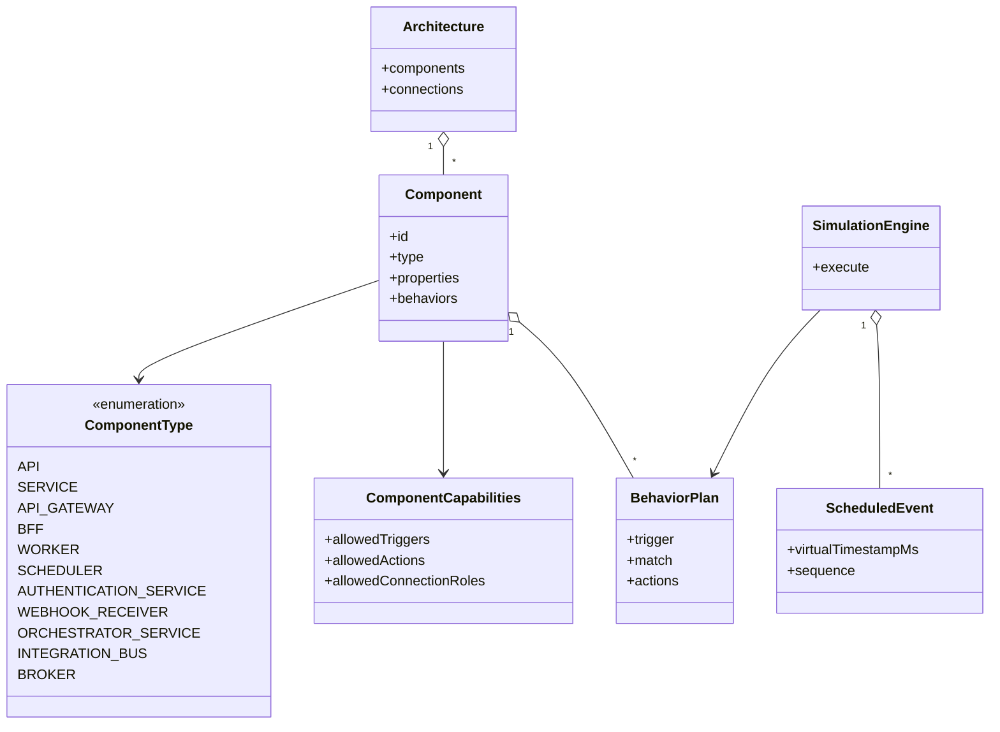

# ADR-V5-001 — Catálogo de serviços por capacidades e Behaviors reutilizáveis

> **Status:** proposto para revisão. Documento de arquitetura da v0.5, não autoriza implementação.
> Requisitos: [mvp-v0.5](../requirements/mvp-v0.5.md). Base: [catálogo de serviços v0.3](../requirements/v0.3-services.md), [ADR-V4.1-001](ADR-V4.1-001.md).

## Contexto

A v0.4.1 introduz Behaviors e Actions para simular fluxos mistos. A ampliação da paleta para Service, Gateway, BFF, Worker, Scheduler, Authentication Service, Webhook Receiver, Orchestrator e ESB não deve produzir uma nova engine para cada papel. `API` e `Broker` existentes devem permanecer válidos.

## Decisão proposta

**Separar três dimensões:** `ComponentType` (identidade e defaults), `ComponentCapability` (gatilhos e ações permitidas, direções e propriedades válidas) e `BehaviorPlan` (fluxo configurado pelo usuário).

- O motor recebe operações e eventos causais e executa Actions genéricas via um único scheduler virtual.
- Os tipos podem oferecer **templates de comportamento**, mas o usuário pode configurar as Actions dentro de capacidades permitidas.
- Roteamento, fan-out, autenticação e transformação só serão ações ou metadados especializados quando houver diferença semântica observável e validável.
- Broker conserva recursos próprios de publicação/entrega e não deve virar um Service artificial.
- O tipo `API` legado permanece reconhecido; `SERVICE` é novo tipo, não renomeação automática.
- Perfis da conexão continuam sendo a fonte de verdade para a comunicação. Um Gateway não transforma implicitamente qualquer protocolo em outro.
- Não adicionar transportes reais nem worker em background verdadeiro; toda atividade ocorre em eventos do motor virtual.

## Classes conceituais



Esses são papéis conceituais, não obrigação de novas classes com esses nomes. As enumerações Client e Database existentes continuam no domínio.

## Matriz de decisão

| Alternativa | Avaliação |
| --- | --- |
| Um motor distinto para cada serviço | Rejeitada: duplicação e fragmentação do trace |
| Um único Service com ícones cosméticos | Rejeitada: ausência de semântica de gateway, scheduler e worker |
| Tipo + capacidades + Behaviors compartilhados | **Proposta preferida**: reuso com distinções justificáveis |
| Recriar Actions por componente | Rejeitada: rompe modelo modular da v0.4.1 |
| Converter automaticamente API em SERVICE | Rejeitada: risco de regressão de cenários salvos |

## Sequência de referência

```mermaid
sequenceDiagram
    participant C as Web Browser
    participant G as API Gateway
    participant S as Service Pedidos
    participant B as Broker
    participant W as Worker
    participant D as Database
    C->>G: REST POST /pedidos
    G->>S: CALL encaminhado
    S->>B: PUBLISH PedidoCriado
    B-->>S: Accepted
    S-->>G: 202 Accepted
    G-->>C: 202 Accepted
    Note over C,D: mainStatus = COMPLETED; atividades derivadas seguem
    B-->>W: MESSAGE_CONSUMED
    W->>D: CALL DB
    D-->>W: Completed
    Note over C,D: globalStatus = COMPLETED quando operações/recursos encerram
```

## Semântica por componente

- **Service**: permite executar Actions do núcleo com múltiplas interfaces compatíveis.
- **Gateway**: regra explícita por operação/rota → connectionId. Sem match, erro rastreável. Timeout de encaminhamento não cancela automaticamente a operação remota.
- **BFF**: ações `CALL` e `JOIN` para composição; resposta final definida por `RESPOND`.
- **Worker**: consumo ativa Behavior e gera operação derivada. Aceite da publicação não equivale à conclusão do processamento.
- **Scheduler**: dispara quantidade finita de eventos no clock virtual. Deve expor `scheduleId`, número, timestamp e vínculo causal. Não se repete infinitamente.
- **Authentication Service**: decisão simulada e determinística; sem senha ou token reais. Definir mecanismo de branch/condição antes da implementação.
- **Webhook Receiver**: evento HTTP virtual ingressante que ativa Behavior; não criar endpoint público de verdade.
- **Orchestrator**: coordena dependências, estados e erros via Actions; não duplica `ExecutionLifecycle`.
- **ESB**: transformação lógica configurada e tempo de processamento, depois encaminhamento explícito; não adota semântica de Broker.

## Migração e testes

- `API` em arquivos antigos mantém tipo e comportamento; importação não muda IDs/tipos.
- `Broker` continua existente.
- Editor deverá distinguir os novos nós sem deteriorar drag/drop, conexões ou seleção.
- Matriz de perfis e topologia deve ser testada para todos os tipos.
- Cenários v0.1–v0.4.1 têm regressão obrigatória.
- Um fluxo v0.5 com Gateway → Service → Broker → Worker → Database deve manter main/global e timeline correlacionadas.

## Questões bloqueantes antes do OpenAPI

1. Nomes finais e tipos discriminados para nove novos componentes.
2. Compatibilidade de gatilhos e ações em cada componente; herança versus composição no código.
3. Modelo de routing do Gateway e do ESB; modelo de decisão de autenticação.
4. Novo trigger `SCHEDULED` e como ele interage com o conceito de operação principal e horizonte finito.
5. Se condicional baseado em resultado de Action faz parte da v0.5 ou vira incremento posterior.
6. Tratamento de timeouts locais por componente sem violar o clock virtual.
7. Efeitos no schema Java/TypeScript e no endpoint `/api/v1`.

**Gate final:** aprovação do catálogo e dessas decisões antes de alterar Java, OpenAPI ou frontend.
