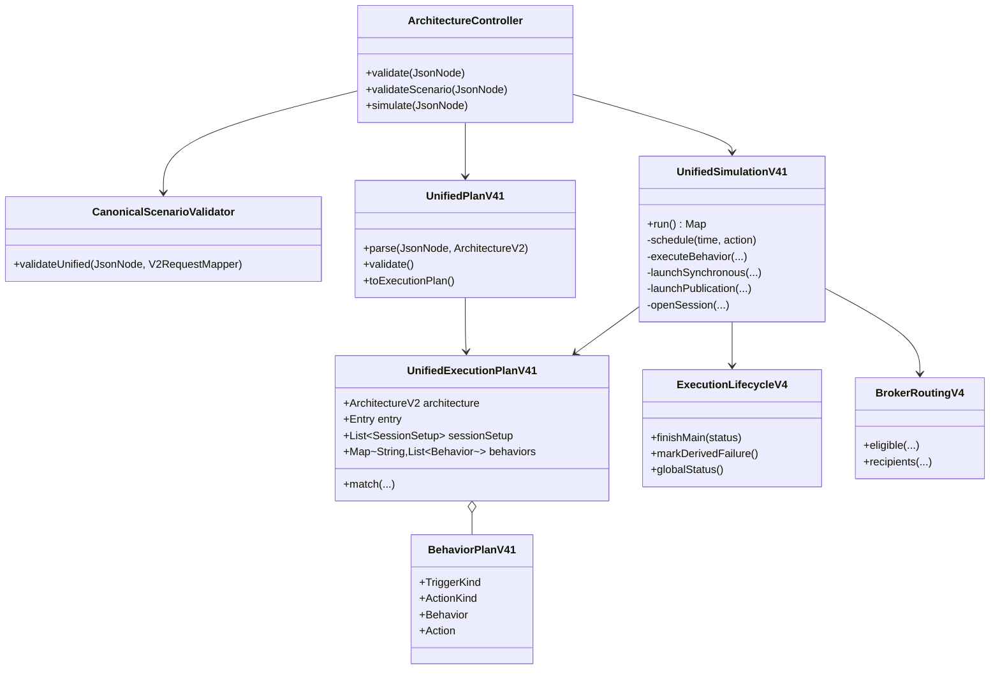
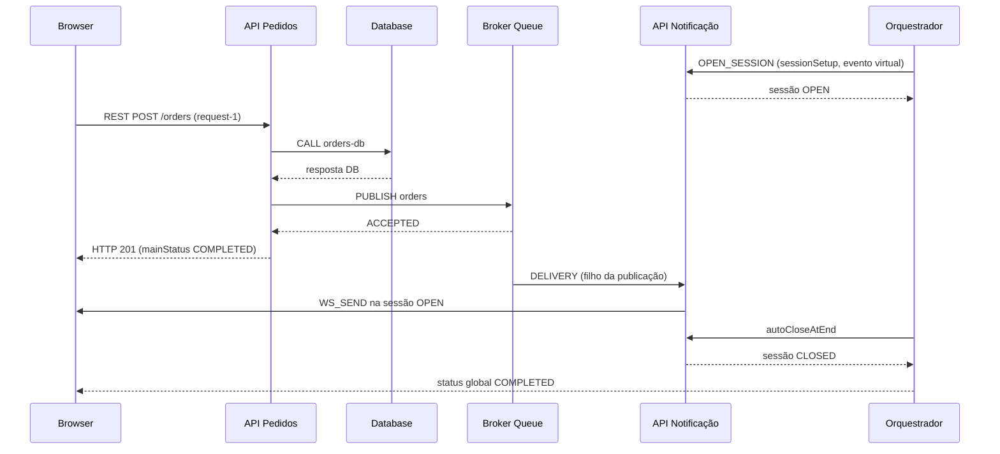

# BE v0.4.1 — implementação e defesa técnica

## Escopo e decisão

O backend aceita um `UnifiedScenario` com uma conexão inicial e comportamentos declarativos nas APIs. Cada comportamento tem um gatilho e ações com dependências locais. Uma conexão sozinha não inicia trabalho derivado. A implementação preserva os formatos v1 e v0.4 no controlador. O frontend não foi alterado nesta branch.

| Tarefa | Implementação e evidência |
| --- | --- |
| BE-01 | OpenAPI 3.1 parseado, lintado, exemplos validados e TypeScript gerado; evidência em `docs/api/OPENAPI-V4.1-VALIDATION.md`. |
| BE-02 | `BehaviorPlanV41` e `UnifiedExecutionPlanV41` imutáveis no core, com tipos de gatilho e ação. |
| BE-03 | `UnifiedPlanV41` valida entrada, topologia, matcher ambíguo, capacidades, dependências, sessão e limites; testes 200/400/422. |
| BE-04 | `UnifiedSimulationV41` usa uma fila ordenada por instante virtual e sequência de inserção; replay idêntico testado. |
| BE-05 | `CALL` espera retorno de API/Database; `PROCESS`, `RESPOND`, timeout e FORK/JOIN dependem do mesmo relógio. |
| BE-06 | Publicação e aceite são distintos da entrega; Queue usa round-robin e Topic/MQTT fan-out pelo `BrokerRoutingV4` compartilhado. |
| BE-07 | Abertura, envio e fechamento WebSocket têm estado explícito; envio requer sessão OPEN. A sessão de entrada pode ativar REST e responder por WS. |
| BE-08 | `ExecutionLifecycleV4` agrega falhas derivadas sem desfazer a operação principal; trace, timeline, métricas e correlação são emitidos. |
| BE-09 | `/api/v1` aceita a variante unificada e preserva os três formatos de cenário v0.4 e o payload v1 direto. |
| BE-10 | Testes HTTP de fluxo misto, falhas, determinismo, FORK/JOIN e regressões antigas; verificação ao vivo do OpenAPI. |

## Estrutura

`archlab-api` decodifica JSON e devolve erros HTTP. `archlab-simulation-core` não depende de Spring ou Jackson. O motor composto reutiliza o domínio `v2`, o lifecycle e as regras de roteamento do Broker; para a entrada WebSocket reaproveita os tempos e spans de `WebSocketRuntimeV4`, inseridos na fila única. `BrokerRuntimeV4` continua servindo os cenários antigos e compartilha `BrokerRoutingV4` com o motor novo.

## Sequência REST → Broker → WebSocket

A fila ordena eventos por `(timestampMs, insertionOrder)`. `CALL` bloqueia apenas ações dependentes; `PUBLISH` libera o chamador no aceite e agenda entregas derivadas. `RESPOND` conclui a operação principal depois do transporte de resposta. O global termina quando não há eventos pendentes nem recurso ativo. Uma falha no consumidor após HTTP 201 produz `COMPLETED_WITH_ERRORS`, mantendo `mainStatus: COMPLETED`.

## Regressão e casos de aceitação

- CT-01: REST → API → Database em `restDatabaseQueueAndWebSocketShareClockAndCausality`; regressão anterior em `V4ApiConsolidationTest`.
- CT-02: REST → API A → API B por gRPC em `grpcCallToSecondApiUsesTheSameRootExecution`.
- CT-03: REST → Queue → consumidor, com resposta anterior à entrega, no teste misto.
- CT-04: Topic e MQTT com dois consumidores em `topicAndMqttUseFanoutWithTwoConsumers`.
- CT-05: REST → Broker → WS no teste misto e exemplo OpenAPI executado ao vivo.
- CT-06: WS → REST → WS em `websocketMessageCanCallRestThenReplyOnSameSession`.
- CT-07: Queue sem consumidor em `queueWithoutConsumerTerminatesAfterVirtualTimeout`.
- CT-08: sessão ausente em `missingSessionFailsValidationWithoutImplicitOpen`.
- CT-09: falha após resposta em `consumerFailureDoesNotUndoCompletedHttpResponse`.
- CT-10: replay byte a byte no teste misto; desempate pela sequência de inserção.
- CT-11: suítes legadas, 12 exemplos antigos positivos e 3 negativos executados ao vivo.

O exemplo adicional `mixed-communication.json` é o mesmo do OpenAPI. `FORK/JOIN`, dependência cíclica, matcher ambíguo, ação desconhecida e aresta sem ação têm testes dedicados. O frontend corresponde ao CT-12 e fica para as tarefas FE, fora deste PR.

## Limites e decisões

- Eventos: 50.000; recursos: 1.000; tempo virtual total: 3.600.000 ms; ações por comportamento: 100; ações agregadas: 10.000. Ao exceder, `/api/v1/simulations` devolve 422 com `EXECUTION_LIMIT_EXCEEDED`.
- `sessionSetup` abre por evento causal. `autoCloseAtEnd: true` fecha ao esvaziar o trabalho; `false` requer `idleTimeoutMs` finito. `WS_SEND` em sessão ausente é inválido estaticamente; em sessão já fechada falha como evento, sem entrega inventada.
- A variante unificada não reinterpreta `scenario.kind`. Formatos antigos continuam nos motores existentes. A retirada futura desses formatos exige versão e migração separadas.
- Ainda não há transporte real, confirmação de entrega externa, QoS avançado, DLQ ou reconexão. Essas capacidades não fazem parte da simulação semântica v0.4.1.
