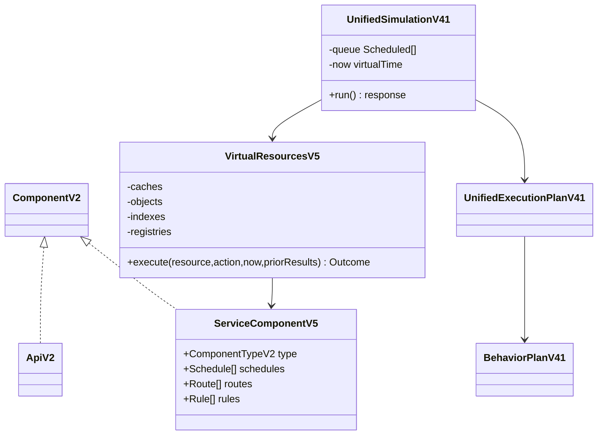

# Backend v0.5 — implementation notes

The v0.5 components extend the existing `ArchitectureV2` and `UnifiedSimulationV41` execution path. All v0.5 Actions run on its single virtual event queue and clock. Resource state belongs to one `UnifiedSimulationV41` instance and is discarded after the run. No external infrastructure is accessed.



```mermaid
sequenceDiagram
    participant Client
    participant Service
    participant Engine as UnifiedSimulationV41
    participant Cache as VirtualResourcesV5
    participant Database
    Client->>Service: GET /orders
    Service->>Engine: CACHE_GET via connectionId
    Engine->>Cache: operation at virtual time
    Cache-->>Engine: ResourceOutcome(MISS)
    Engine->>Engine: BRANCH reads outputRef; HIT branch SKIPPED
    Engine->>Database: CALL selected connection
    Database-->>Engine: response
    Engine-->>Client: one RESPOND
```

## Component roles

`SERVICE` hosts general Behaviors and explicit Actions. `API_GATEWAY` requires request operation matches and route connections. `BFF` composes explicit CALL Actions. `WORKER` consumes Broker deliveries; `NOTIFICATION_SERVICE` is a virtual destination with EMAIL, SMS, and PUSH outcomes. `SCHEDULER` emits finite `SCHEDULED_TRIGGER` events on the shared queue. `AUTHENTICATION_SERVICE` uses `EVALUATE_RULE` and BRANCH for fictitious authorization. `WEBHOOK_RECEIVER` accepts virtual HTTP and forwards by Action. `ORCHESTRATOR_SERVICE` coordinates explicit CALL/PUBLISH dependencies. `INTEGRATION_BUS` performs a descriptive TRANSFORM and explicit forwarding. `CACHE`, `OBJECT_STORAGE`, `SEARCH_ENGINE`, `SERVICE_REGISTRY`, and `RULES_ENGINE` own bounded per-run state or decisions.

Resource Actions require a directed request/response connection to the matching resource type. Discovery returns logical target IDs and never adds graph edges. Search matches exact tags and sorts document IDs. Cache TTL expires at `now >= expiresAt`; zero TTL is never readable. Object Storage retains size and bounded metadata only. Rules are sorted by descending priority and use declaration order for ties; missing matches use an explicit default decision. Notifications simulate delivery and never contact a provider.

The runtime appends `resourceOutcomes` to the existing `/api/v1/simulations` response. Each outcome has a virtual timestamp and causal operation ID. BRANCH reads a predecessor `outputRef`, executes one case, and emits `SKIPPED` for discarded Actions and their dependents. No connection is traversed without an Action.

## Known limits pending final review

- The legacy API migration adapter is not yet wired into an import flow. Historical API scenarios continue through their existing path.
- Some type specific validation and failure semantics remain to be hardened before BE5-03 through BE5-15 can be called complete.
- Rules currently compare prior Action result codes; the contract does not yet expose scenario attributes as rule inputs.
- Gateway route fallback and Scheduler policies for main/global status need additional acceptance tests.
- `TRANSFORM` records descriptive metadata but does not rewrite payload bytes.
