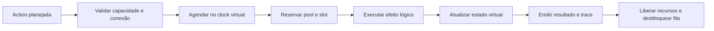

# BE-V6-001 — Planejamento técnico do backend v0.6

> **Status:** desenho de implementação, não código executado.
> **Referências:** [requisitos](../requirements/mvp-v0.6.md), [ADR](ADR-V6-001.md), [domínio](DM-V6-001.md), [contrato](../api/API-V6-001.md).
> **Princípio:** reutilizar `UnifiedSimulationV41` e seu relógio/fila virtual; não criar engine por banco.

## 1. Pontos de integração com o repositório atual

- `backend/archlab-simulation-core`: domínio, validação, Behaviors, Actions, executor e estado virtual por simulação.
- `backend/archlab-api`: mappers/DTOs do `/api/v1`, validação de requests, resultados, migração e testes de contrato.
- O runtime v0.5 já mantém recursos virtuais por execução. Dados v0.6 devem reutilizar esse ciclo de vida, sem estado estático/global.
- `DATABASE` antigo continua no adaptador legado enquanto houver arquivos anteriores; runtime canônico usa apenas tipos concretos após migração.
- Nome de classes abaixo é sugestão, não comando para duplicar o runtime.

## 2. Decomposição sugerida

| Responsabilidade | Abstração candidata | Regra |
| --- | --- | --- |
| Tipos e capacidades | `DataCapabilitiesV6` | Tabela única de Actions e destinos permitidos |
| Modelo de entrada | `DataActionPlanV6` | Dados tipados e referências validadas |
| Estado por execução | `VirtualDataResourcesV6` | Mapas/coleções limitadas por componente |
| Operações tipadas | `DataActionExecutorV6` | Dispatch determinístico sem thread externa |
| Concorrência | `DataResourceSchedulerV6` | Respeitar slots/filas no agendador existente |
| ETL | `EtlBatchRuntimeV6` | Batches finitos e Actions encadeadas |
| Resultados | `DataOutcomeMapperV6` | Serialização aditiva e causal |
| Compatibilidade | `DatabaseMigrationV6` | Conversão em cópia com relatório e validação |

Evitar hierarquia de classes para cada banco quando regras configuráveis tipadas forem suficientes.

## 3. Pipeline de execução

- Disponibilidade de slot/connection pool, capacidade de fila e timeout devem ser modelados por eventos; não usar `Thread.sleep`/threads por requisição.
- Ordenação: timestamp virtual + sequência estável já existente.
- `DB_INSERT` só se torna visível para consultas quando a Action conclui com sucesso.
- `DB_SELECT` e `DB_FIND` consultam o estado confirmado naquele instante de atendimento.
- Um mesmo modelo/seed produz igual ordem de alterações e trace.
- Operações na mesma execução compartilham estado do mesmo nó; execuções distintas nunca compartilham dados.

## 4. Runtime P0 por categoria

**Relational:** mapa de coleções/tabelas lógicas e chaves, contagem e tamanho médio; SELECT/INSERT/UPDATE/DELETE/BULK com custos declarativos. Sem parser SQL, joins ou isolamento transacional nesta fase.

**Document:** mapas `documentId → campos/tags limitados`; GET/PUT/FIND e UPDATE/DELETE declarativos. FIND realiza igualdade sobre campos autorizados com ordenação estável.

**Key-Value:** mapa `key → valueMetadata` virtual; GET/PUT/DELETE, resultado `FOUND/NOT_FOUND`. Diferenciar do CACHE v0.5: sem TTL/fallback implícitos.

**ETL Pipeline:** gera `batchId`, EXTRACT de origem, TRANSFORM declarativo e LOAD ao destino somente por dependência explícita. Filtros que removem itens devem registrar `inputCount`, `filteredCount` e `outputCount`; operações que expandem registros fora do P0.

**Data Transformer:** aceita transformação finita e retorna resultado de lote com custo por registro; não executa expressões de usuário.

## 5. Modelo de custo e contenção

Custo P0 ilustrativo: `serviceTimeMs = baseLatencyMs + recordCount × perRecordLatencyMs`, com verificação de overflow e budgets. Total da operação soma fila, atendimento e transporte conforme timeline existente; não contar latência de conexão duas vezes.

`connectionPoolSize` e `maxConcurrentOperations` precisam de semântica distinta, testada: pool limita conexões admitidas; slots limitam operações simultâneas no recurso. O limite efetivo não deve ser calculado por multiplicação acidental. Quando recursos estão saturados, fila FIFO limitada por nó e timeout virtual.

### Falha e atomicidade simplificada

P0: uma Action individual confirma o seu efeito lógico somente em `SUCCEEDED`; falha/timeout não deixa escrita parcial, exceto `DB_BULK_INSERT` quando política `PARTIAL` estiver declarada e houver contagens explícitas. Não introduzir `COMMIT/ROLLBACK` antes da definição de transações P1.

ETL: erro de TRANSFORM cancela LOAD dependente por padrão, com estado `SKIPPED` e erro original correlacionado. Políticas de recuperação avançadas requerem Action explícita (não fallback escondido).

## 6. Validação e migração

- Importador identifica apenas `type: DATABASE` em arquivos históricos; `RELATIONAL_DATABASE` é destino padrão **sugerido**, nunca conversão silenciosa.
- Produz relatório: componente, campos preservados, defaults, incompatibilidades e impacto nas conexões `DATABASE_QUERY`.
- Aplica em cópia, valida modelo e cenário; somente depois da confirmação do usuário modifica canvas. Backend nunca reinterpreta um nó canônico silenciosamente.
- Preservar `/api/v1`, Actions antigas e `resourceOutcomes` da v0.5.
- A migração `API → SERVICE` da v0.5 continua válida em cadeia, sem duplicação ou renomeação de IDs.

## 7. Estratégia de testes

| Teste | Resultado obrigatório |
| --- | --- |
| Inserir e consultar | SELECT observa INSERT concluído e não observa escrita futura |
| Atualizações concorrentes | Ordem estável com mesmo timestamp |
| Pool 1 / 2 chamadas | Segunda espera; timeout e fila visíveis |
| Documento | FIND declarativo ordena resultados consistentemente |
| Key-Value | GET miss → PUT → GET hit sem TTL |
| ETL | Contadores conservados, batch finito, falha bloqueia LOAD |
| Limites | Sem overflow, loop infinito ou alocação ilimitada |
| Isolamento | 2 simulações independentes começam com mesmo estado inicial |
| Migração | Preserva semântica, IDs, conexões e outputs canônicos |
| Regressão | Reproduz fluxos REST/Broker/WebSocket/Cache v0.1–v0.5 |

## 8. Critérios de conclusão

Maven tests, contratos `/api/v1`, fixture histórica, integração frontend/backend, determinismo, recursos finitos e métricas causais devem passar. Sem implementação de P1/P2 por antecipação.
