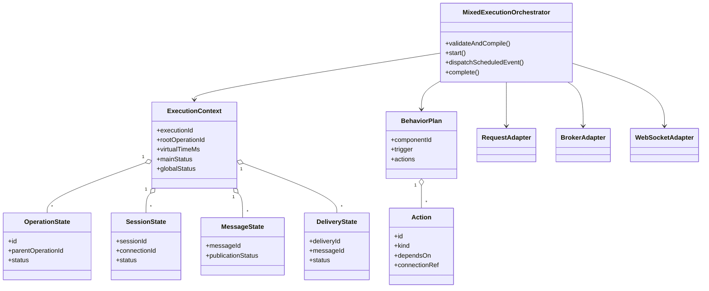
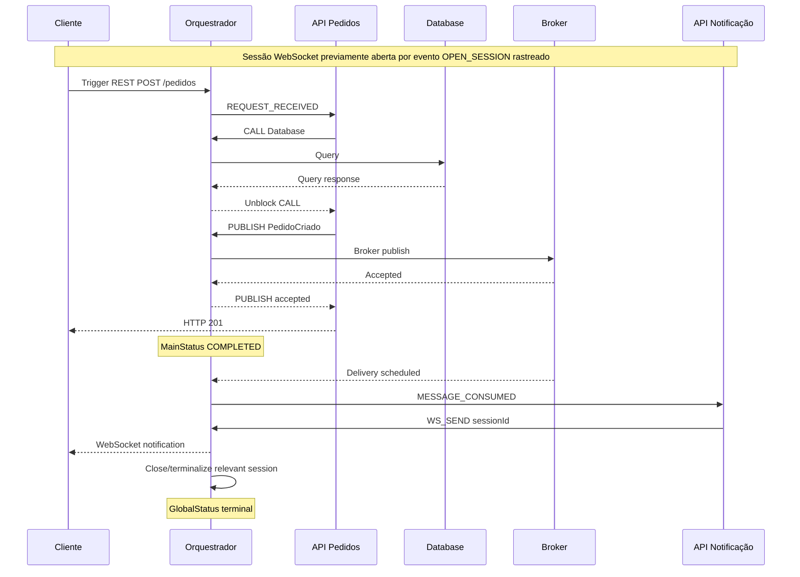

# EX-V4.1-001 — Orquestrador determinístico de comunicação mista

> **Status:** especificação normativa proposta; revisão exigida antes da implementação.
> Escopo: Java 25 / `archlab-simulation-core`, simulação sem rede real.
> Requisitos: [mvp-v0.4.1](../requirements/mvp-v0.4.1.md); decisão: [ADR-V4.1-001](ADR-V4.1-001.md).

## 1. Inventário verificado (branch develop em 2026-11-04)

- `v2/ScenarioV2`: `entryComponentId`, `entryConnectionId`, `apiExecutions`.
- `v4/WebSocketRuntimeV4`: método `run(WebSocketIntegrationV2, long)` executa **a sessão inteira isoladamente**, com intervalo de mensagens; não expõe operações agendáveis por outros participantes.
- `v4/BrokerRuntimeV4`: método `run(ArchitectureV2, ConnectionV2, BrokerV2, String, int)` executa **publicação e entregas inteiras isoladamente**, com ordenação de assinaturas e limitação de entregas.
- `v4/ExecutionLifecycleV4`: `MainStatus` separado de `GlobalStatus`, recursos `WEBSOCKET_SESSION`, `BROKER_MESSAGE`, `DELIVERY`; limite existente de 3.600.000ms e 50.000 eventos.
- `api/CanonicalScenarioValidator`: despacho por `scenario.kind` apenas para `WEBSOCKET_SESSION` e `MESSAGE_PUBLISH`; resposta/entrada síncrona precisa revisão pelo caminho correspondente.
- `core/event` e `core/engine`: infraestrutura anterior de fila, relógio virtual, engine, transport e trace.

**Consequência:** não encadear chamadas de `run()` completas e somar tempos. Extração/refatoração para **transições menores agendadas no mesmo relógio e fila**, preservando os comportamentos anteriores.

## 2. Modelos e invariantes

**ExecutionContext** (conceitual): `executionId`, snapshot da arquitetura, `rootOperationId`, relógio virtual, fila única de eventos, contador sequencial, mapa de operações, sessões, publicações, entregas, trace e recursos.

**BehaviorPlan**: comportamentos por componente, cada um com gatilho, critério de correspondência e ações finitas. Não é linguagem de script.

**Action**: `id`, `kind`, `connectionRef?`, `dependsOn[]`, propriedades específicas. Identificador único dentro do comportamento; grafo de dependências acíclico.

**Operation**: `id`, `parentOperationId?`, `rootOperationId`, `triggerEventId`, `componentId`, `connectionId?`, `integrationKind?`, `status`, `startedAt`, `finishedAt?`.

**VirtualResource**: sessão, publicação, entrega, operação em andamento. Nenhum recurso pode ser finalizado duas vezes.

### 2.1. Gatilhos e capacidades

| Gatilho | Consumidor | Descrição |
| --- | --- | --- |
| `REQUEST_RECEIVED` | API | Recebe chamada de request/response após trânsito pela conexão. |
| `MESSAGE_CONSUMED` | API consumidora | Recebe delivery individual validado pelo Broker. |
| `WS_MESSAGE_RECEIVED` | Cliente/API conforme capacidade | Recebe mensagem numa sessão OPEN. |
| `SESSION_OPENED` | Participante de sessão | Reage à abertura de sessão, se comportamento configurado. |

Uma operação inicial é gatilho explícito do cenário e não exige novo tipo de nó. Não gerar ações apenas por haver conexões. Uma única ação pode gerar uma operação derivada cuja chegada aciona outro comportamento.

### 2.2. Ações mínimas para a primeira implementação

| Ação | Semântica e pré-condição |
| --- | --- |
| `PROCESS` | Aplica tempo virtual de processamento do componente; nunca latência de rede. |
| `CALL` | Requer aresta compatível de request/response; cria filho e espera resposta/timeout para liberar dependentes. |
| `PUBLISH` | Requer aresta API/Cliente → Broker com perfil mensageria; cria publicação e entregas derivadas. |
| `RESPOND` | Conclui a requisição atual; requer contexto de resposta válido, nunca publicação sem chamador. |
| `OPEN_SESSION` | Requer aresta WebSocket válida; inicia negociação virtual e recurso de sessão. |
| `WS_SEND` | Requer referência a sessão OPEN; agenda mensagem com latência; não abre sessão implicitamente. |
| `CLOSE_SESSION` | Solicita encerramento terminal; mensagens posteriores falham de forma observável. |
| `FORK` | Agenda ações filhas independentes, respeitando limites e ordem estável. |
| `JOIN` | Libera próximos passos após terminalidade das ações explicitamente aguardadas. |

Configuração `dependsOn[]` determina dependência local. `CALL` sincroniza pela resposta; `PUBLISH` pode desbloquear pelo aceite do Broker, **não pelo processamento do consumidor**, salvo JOIN explícito com operação derivada identificável.

## 3. Máquina de estados e término

| Entidade | Estados (mínimo) | Terminais |
| --- | --- | --- |
| Operação | CREATED → READY → RUNNING → WAITING → COMPLETED | COMPLETED, FAILED, TIMED_OUT, CANCELLED |
| Ação | PENDING → READY → RUNNING → FINISHED | COMPLETED, FAILED, TIMED_OUT, SKIPPED |
| Sessão | CONNECTING → OPEN → CLOSING → CLOSED | CLOSED, FAILED, TIMED_OUT |
| Publicação | CREATED → IN_TRANSIT → ACCEPTED | ACCEPTED, FAILED, TIMED_OUT |
| Entrega | SCHEDULED → IN_TRANSIT → DELIVERED → PROCESSING → PROCESSED | PROCESSED, FAILED, TIMED_OUT |

**Importante:** `ACCEPTED` é terminal para a **publicação**; a conclusão global continua dependendo das entregas. Um Broker sem consumidor mantém mensagem pendente apenas até o prazo virtual definido; ao atingir o prazo, registra TIMED_OUT com motivo.

### 3.1. Finalização principal/global

- `mainStatus`: terminalidade do gatilho/operacão principal (por exemplo, resposta HTTP emitida ou publicação aceita).
- `globalStatus`: **não pode terminar** com operações/entregas/sessões relevantes vivas, mesmo após `mainStatus=COMPLETED`.
- `COMPLETED`: principal e derivadas relevantes terminaram sem erro.
- `COMPLETED_WITH_ERRORS`: principal completou e alguma derivada terminou com erro/timeout/cancelamento.
- `FAILED` ou `TIMED_OUT`: operação principal falhou ou expirou; manter motivo e falhas derivadas.
- Sessão WebSocket OPEN tem duas políticas válidas: encerramento explícito no plano, ou `autoCloseAtEnd=true` declarado no cenário. Na ausência das duas, rejeitar na validação cenários sabidamente sem condição de terminalidade ou impor `sessionDeadlineMs` explícito para cenários cuja terminalidade dependa de runtime. Nada fica aberto indefinidamente.
- `sessionDeadlineMs` é tempo virtual, respeita teto existente de 3.600.000ms; não representa tempo de parede.
- Política de recursos inicializados: **não permitir sessão inicial arbitrariamente OPEN no contrato**; sempre registrar evento OPEN_SESSION e sucesso de abertura antes de WS_SEND.

## 4. Scheduler unificado — transições determinísticas

Não executar submotores completos como caixas-pretas. Adapter de WebSocket/Broker deve emitir pequenas intenções ou eventos sobre o scheduler compartilhado.

Ordem total por `(virtualTimeMs, schedulerPhase, insertionSequence)`. `schedulerPhase` deve **reutilizar a ordem de fases já existente**, sem mudar arbitrariamente as prioridades de v0.1–v0.4. `insertionSequence` é monotônico e determinístico. Para ações liberadas simultaneamente, desempatar por ordem de declaração e identificador estável.

Algoritmo conceitual:
```text
validate architecture, behaviors, entry and budgets
compile immutable behavior plans and event dependencies
context = initialize single virtual clock and deterministic event queue
enqueue root trigger at virtual t=0
while eventQueue not empty:
    next = dequeue by (t, phase, sequence)
    enforce event count and virtual duration limits
    atomically apply event to operation/resource state
    persist trace entry with cause and correlation
    schedule newly enabled actions and transport transitions
    if root reaches terminal: record mainStatus, do not stop queue
    when all tracked work/resources are terminal: determine globalStatus
if orphan ACTIVE resources exist:
    terminalize through declared deadline/timeout or reject inconsistent state
return reproducible trace, timeline, metrics and statuses
```

### 4.1. Reentrância e prevenção de duplicações

- Cada evento agendado possui `eventId` e causalidade; efeitos aceitos uma única vez.
- Entrega a dois assinantes cria dois `deliveryId` distintos com um mesmo `messageId`; nunca duplicar processamento por retry implícito.
- `parentOperationId` aponta para o gerador causal, não para o componente de origem meramente visual.
- Reações recursivas precisam obedecer limite de profundidade **a definir no contrato** e proibição de reentrância infinita; ciclos semântico-causais sem condição finita são inválidos.
- Mantêm-se limites v0.4: até 50.000 eventos e 3.600.000ms globais, sujeitos à validação de compatibilidade de payload legado; limites adicionais nunca devem contradizer `docs/api/openapi.yaml`.

## 5. UML conceitual (Mermaid)



**Nota:** classes e adapters são responsabilidades conceituais, não exigência de criar classes duplicadas na implementação. Reaproveitar `ExecutionLifecycleV4` e tipos `v2` existentes conforme avaliação do backend.

## 6. Diagrama de sequência — REST, Queue e WebSocket



## 7. Erros e observabilidade

Trace mínimo: `executionId`, `eventId`, `virtualTimestampMs`, `eventType`, `operationId`, `parentOperationId?`, `componentId?`, `connectionId?`, `integrationKind?`, `messageId?`, `deliveryId?`, `sessionId?`, `fromStatus?`, `toStatus?`, `errorCode?`.

Nunca esconder falha assíncrona na resposta principal. Timeline deve ter visão agrupada por causalidade e por componente, sem perder playback cronológico. Métricas mínimas: latência por conexão, processamento, tempo de espera/entrega de Broker, duração da sessão WebSocket, tempo principal e total.

## 8. Sequência de implementação backend

| Ordem | Subtarefa | Critério de saída |
| --- | --- | --- |
| BE-01 | Compilador/validador de BehaviorPlan | Grafo de ações validado, triggers/capacidades verificadas, erros estruturados. |
| BE-02 | Contexto e scheduler unificado | Uma fila, um clock e IDs causais estáveis; teste de desempate. |
| BE-03 | Adaptar chamada síncrona | REST → API/DB e REST → outra API sem regressão v1/v2. |
| BE-04 | Integrar Broker por eventos | Aceite, fan-out/round-robin e consumos derivados no mesmo contexto. |
| BE-05 | Integrar sessão WebSocket por eventos | Abrir, enviar, receber e fechar na mesma timeline; envio sem OPEN rejeitado. |
| BE-06 | Conclusão/erros e resultado | Main/global separados, falhas parciais e limites finitos. |
| BE-07 | Testes ponta a ponta e compatibilidade | CT-01 a CT-11, determinismo, falhas e cenários v0.1–v0.4. |

## 9. Evidências obrigatórias na defesa técnica

O backend deve fornecer:
1. UML final com classes efetivas e responsabilidades (comparada ao diagrama conceitual).
2. Diagrama de sequência de REST → Broker → consumidor → WebSocket, indicando um único relógio e event queue.
3. Matriz de estados e transições/erros com idempotência.
4. Resultados executáveis de regressão das versões anteriores e cenários de falha.
5. Justificativa explícita de reuse/refactor de `BrokerRuntimeV4`, `WebSocketRuntimeV4` e `ExecutionLifecycleV4` em vez de engines paralelas.

**Gate:** não alterar backend até que esquema contratual de ações e política de sessão estejam reconciliados com o OpenAPI atual.
