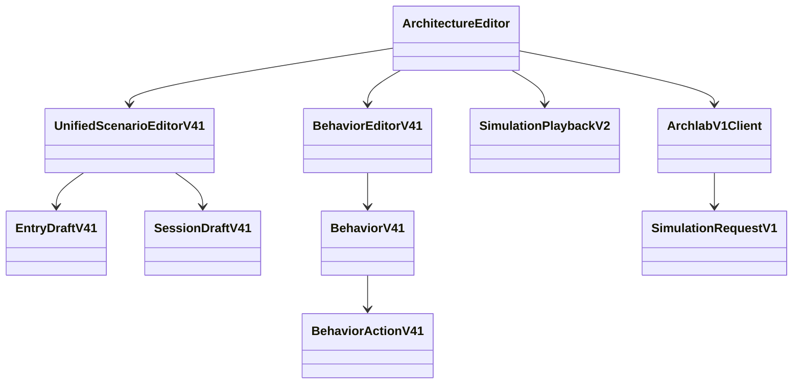
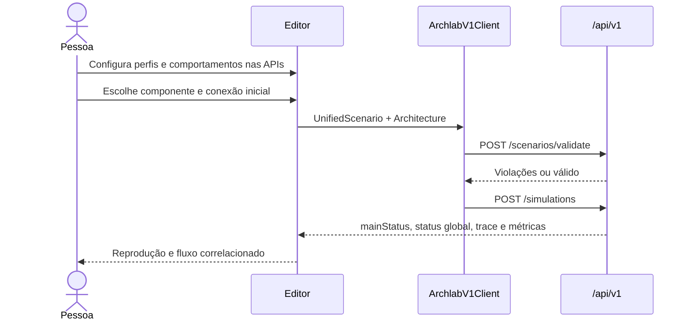

# Frontend v0.4.1 — execução mista

## Escopo FE-01 a FE-05

| Cartão | Entrega |
| --- | --- |
| FE-01 | Tipos TypeScript gerados do OpenAPI canônico; request unificado enviado ao cliente `/api/v1`. Formatos antigos continuam aceitos pelo backend, mas a criação nova usa `scenario.entry`. |
| FE-02 | Entrada por componente e conexão, operação derivada do perfil ou ajustável; nenhum seletor obrigatório de tipo global. Preparação opcional de sessões WebSocket. |
| FE-03 | Painel da API com gatilho, matcher, ações, dependências e campos próprios de cada ação. Conexões são escolhidas por capacidade. |
| FE-04 | Reprodução preserva pausa, passo e velocidade, distingue `mainStatus` de status global e mostra trace correlacionado no tempo virtual. |
| FE-05 | Build, lint, testes de componentes e integração de request. Regressões de movimento, seleção, conexões e zoom continuam na suíte React Flow. |

## Fluxo do editor

## Compatibilidade e limites

O editor cria apenas `UnifiedScenario` na v0.4.1. O cliente continua aceitando `SimulationRequestV1`, inclusive variantes legadas. A edição visual de planos legados não foi adicionada, porque o editor anterior não oferecia importação de cenários persistidos. Validações semânticas finais pertencem ao backend e aparecem como violações no editor. O trace correlacionado mostra a ordem virtual retornada pelo backend; não há rede real para Broker ou WebSocket.

O teste visual direto no navegador Windows não pôde ser concluído nesta execução: a ferramenta Computer Use encerrou a sessão porque não conseguiu determinar com confiança a URL atual do Chrome. Build, lint e testes automatizados permanecem disponíveis como evidência reproduzível.

## Verificações executadas

- `npm run build`: TypeScript e Vite aprovados.
- `npm run lint`: sem erros.
- `npm test -- --silent --reporter=dot`: suíte React/Vitest aprovada, incluindo entrada unificada, painel, correlação e payload misto.
- `npm run test:integration:v03`: 24 cenários de clientes antigos aprovados contra o backend local.
- `npm run verify:live` em `docs/api/examples/v0.4`: 13 exemplos positivos e 3 negativos aprovados, incluindo `mixed-communication.json`.
