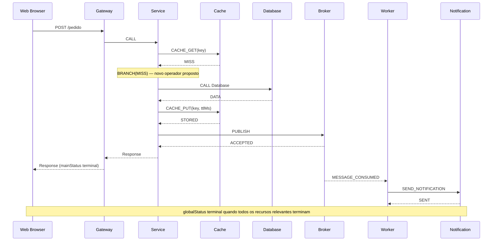

# SEM-V5-001 — Operações, estado virtual e resultados de componentes de serviço

> **Status:** desenho técnico proposto, sujeito à aprovação e reconciliação com o OpenAPI e o motor em `develop`.  
> Referências: [CAP-V5-001](CAP-V5-001.md), [ADR-V5-001](ADR-V5-001.md), [requisitos v0.5](../requirements/mvp-v0.5.md).

## 1. Semântica comum de operação

Contrato conceitual (não é um DTO vigente):

```text
ResourceAction {
  id: Identifier
  kind: ResourceActionKind
  connectionId: Identifier
  dependsOn: Identifier[]
  input: value expression (typed references only; no dynamic code)
  outputRef?: Identifier
  timeoutMs?: DurationMs
}
ResourceOutcome {
  operationId, actionId, resourceId, virtualTimestampMs
  status: SUCCEEDED | FAILED | TIMED_OUT
  resultKind, typedResult, errorCode?
}
```

O `connectionId` aponta para uma aresta válida e dirigida entre componente chamador e recurso lógico. Operações de recurso não usam rede real. O motor registra eventos de envio, chegada, processamento e retorno quando a integração escolhida é síncrona. Estados compartilhados entre Actions usam somente a execução virtual atual, salvo decisão explícita futura.

O `typedResult` deve ser consumível por ações dependentes para apoiar `IF`/branch futuro. Na primeira revisão, priorizar resultados fechados com enums, booleanos, strings limitadas e números, sem linguagem de expressão arbitrária. **Não fazer branch implícito** apenas porque `CACHE_GET` retornou MISS.

## 2. Cache — estados e operações

Estados: `key -> {valueMetadata, insertedAtMs, expiresAtMs?}`, mapa limitado, sem persistência entre simulações.

| Operação candidata | Entrada | Resultado |
| --- | --- | --- |
| `CACHE_GET` | key | `HIT` com metadados ou `MISS` |
| `CACHE_PUT` | key, valueMetadata, ttlMs? | `STORED` |
| `CACHE_INVALIDATE` | key | `REMOVED` ou `NOT_FOUND` |

**Semântica de TTL:** entrada é válida apenas quando `nowMs < expiresAtMs`; exatamente no prazo, retorna MISS. `ttlMs=0` não gera entrada legível. Não usar horário real. Na execução de GET, expiração é avaliada no instante virtual de atendimento da operação (não no instante de agendamento).

**Hit/miss:** o motor reporta a decisão. O Service **só chama Database em MISS** se existir uma Action condicional explícita com essa regra. Não criar chamada oculta ao banco. Recomenda-se um exemplo canônico `CACHE_GET -> IF(MISS): CALL Database -> CACHE_PUT -> RESPOND`, dependente da aprovação de branch tipado.

**Concorrência:** duas leituras no mesmo tempo usam desempate determinístico; valores vistos dependem da ordem total de eventos. Sem locking distribuído.

## 3. Object Storage — estados e operações

Estado: `objectKey -> {sizeBytes, metadata, storedAtMs}`. Não armazenar payload real, somente metadados limitados.

| Operação candidata | Entrada | Resultado |
| --- | --- | --- |
| `OBJECT_PUT` | objectKey, sizeBytes, metadata? | `CREATED` ou `REPLACED` |
| `OBJECT_GET` | objectKey | `FOUND` com tamanho e metadados ou `NOT_FOUND` |
| `OBJECT_DELETE` | objectKey | `DELETED` ou `NOT_FOUND` |

Latência = latência da conexão + processamento virtual do recurso, sem cálculo automático por bandwidth (fora do escopo). Sobrescrita é explícita e determinística; não armazenar versões em v0.5.

## 4. Notification Service — operações e efeitos

Modelo candidato: `SEND_NOTIFICATION` com `channel: EMAIL|SMS|PUSH`, `recipientAlias` fictício, `payloadMetadata` e duração. Resultado `SENT|FAILED|TIMED_OUT`. Evento é **simulado**: não efetuar envios externos e não exigir endereço/telefone reais.

Um disparo originado de `MESSAGE_CONSUMED` mantém `messageId` e `parentOperationId`, enquanto a conclusão principal pode ocorrer antes do envio.

## 5. Search Engine — indexação e consulta

Estado: `indexName -> documentId -> {tags, metadata, indexedAtMs}`.

| Operação candidata | Entrada | Resultado |
| --- | --- | --- |
| `INDEX_DOCUMENT` | indexName, documentId, tags/metadata | `INDEXED` ou `UPDATED` |
| `SEARCH_DOCUMENTS` | indexName, critérios de igualdade de tags | lista limitada e ordenada de IDs |

**Não implementar full-text real**, relevância, analisadores linguísticos, motores remotos nem DSL de consulta. Ordenação por `documentId` estável para reprodutibilidade. Visibilidade de indexação imediata quando INDEX_DOCUMENT termina, salvo escolha posterior por atraso de refresh virtual.

## 6. Service Registry — descoberta lógica

Estado: `serviceName -> instâncias registradas {instanceId, targetComponentId, status, registeredAtMs}`.

| Operação candidata | Entrada | Resultado |
| --- | --- | --- |
| `REGISTER_SERVICE` | name, instanceId, targetComponentId | `REGISTERED` |
| `UNREGISTER_SERVICE` | name, instanceId | `REMOVED` ou `NOT_FOUND` |
| `DISCOVER_SERVICE` | name | `FOUND` com conjunto ordenado ou `UNAVAILABLE` |

A descoberta **não cria conexão lógica nem altera a topologia**. Caso a Action seguinte use um alvo descoberto, ela só pode selecionar uma aresta **preexistente e compatível**. Instâncias inativas são excluídas; sem política de health check real. A escolha de primeira instância ou round-robin é uma regra de aplicação explícita, não Load Balancer oculto.

## 7. Rules Engine — decisão determinística

Modelo proposto: regras ordenadas `{priority, field, operator, expectedValue, decision}` sobre atributos nomeados do cenário ou resultados tipados de Actions. Operadores limitados: `EQ`, `NE`, `GT`, `GTE`, `LT`, `LTE`, `IN` (com tipos comparáveis e sem coerção silenciosa). Sem `eval`, JS, Groovy, SpEL, SQL arbitrário ou expressões de usuário executáveis.

`EVALUATE_RULE` retorna `{decision: ALLOW|DENY|REVIEW|CUSTOM_ENUM, ruleId, reasonCode}` conforme contrato aprovado. Empate: maior prioridade; mesmo nível usa ordem estável de declaração, se permitida. Ausência de match exige default explícito; caso contrário, erro de validação.

**Fluxo condicional exige operador tipado explícito** (por exemplo `BRANCH`), que lê `outputRef` de uma Action concluída e habilita conjunto finito de ações subsequentes. A inclusão de `BRANCH` e seu schema é pendência para o próximo ADR/contrato; não implementar condicionais ocultos.

## 8. Gateway, BFF, Scheduler, Auth, Webhook, Orchestrator e ESB

| Tipo | Comportamento específico proposto | Resultado/erro observável |
| --- | --- | --- |
| Gateway | match de rota/operation -> connectionId; CALL ao destino com resposta | `ROUTE_MATCHED`, `NO_ROUTE`, `UPSTREAM_TIMEOUT` |
| BFF | CALL de 1..N dependências, JOIN e RESPOND | resultado agregado **metadados**, erro por dependência |
| Worker | MESSAGE_CONSUMED ativa Actions e termina delivery | `PROCESSED`, `FAILED`, `TIMED_OUT` |
| Scheduler | eventos SCHEDULED_TRIGGER em timestamps finitos | occurrenceId, scheduledAtMs, firedAtMs |
| Authentication | EVALUATE_RULE sobre dados fictícios de cenário | `AUTHORIZED`, `DENIED`, `ERROR` |
| Webhook Receiver | REQUEST_RECEIVED de POST ilustrativo | response virtual e ações derivadas |
| Orchestrator | CALL/PUBLISH/FORK/JOIN com estados dependentes | progresso causal, falha e join |
| ESB | TRANSFORM metadados e CALL/PUBLISH explícito | `TRANSFORMED`, `ROUTED`, falha de encaminhamento |

A integração deve reutilizar `Behavior` e `BehaviorAction`; não duplicar `SimulationEngine` para cada tipo.

## 9. Um fluxo único para validação



## 10. Critérios de testes

- **CACHE-01:** antes do PUT, GET=MISS; após PUT com TTL, GET=HIT; em `nowMs==expiresAtMs`, GET=MISS.
- **CACHE-02:** miss só aciona Database com BRANCH configurado; sem BRANCH, nenhum fallback implícito.
- **OBJ-01:** PUT/GET/DELETE por ID com metadados; operação posterior ao DELETE retorna NOT_FOUND.
- **NOTIF-01:** falha simulada no envio assíncrono não altera mainStatus já concluído e produz globalStatus adequado.
- **SEARCH-01:** indexação e consulta em ordem determinística; sem full-text.
- **REG-01:** registro, descoberta e remoção; não criar aresta automaticamente.
- **RULE-01:** prioridade/default/sem match e operador inválido; sem execução de código arbitrário.
- **SCHED-01:** quantidade/horizonte finitos, clock virtual e operações correlacionadas.
- **LEGACY-01:** arquitetura v0.4.1 Browser→API→Broker→API→Database permanece válida.
- **DETERMINISM-01:** duas execuções com mesmas entradas produzem sequência causal equivalente.

## 11. Decisões para OpenAPI e UX

1. `ResourceAction`: adicionar kinds ao `BehaviorAction.oneOf` atual ou adotar subcontrato de operações do recurso — não ambos sem justificativa.
2. Definir `ResourceOutcome` e `outputRef` tipados, mantendo compatibilidade da timeline atual.
3. Introduzir `BRANCH` como ação explicitamente tipada ou limitar v0.5 a decisões observáveis sem desvio de fluxo.
4. Resolver tipo de `integration.kind` para conexões a recursos.
5. Definir `SCHEDULED_TRIGGER` e política de operação principal.
6. Definir limites de entradas de cache/objetos/índices, sem extrapolar budgets existentes.
7. Validar que a paleta e editor de Actions só oferecem controles aplicáveis ao componente.

**Gate:** este documento é proposta. Não marcar funcionalidade como implementada e não editar `openapi.yaml` antes das decisões contratuais.
