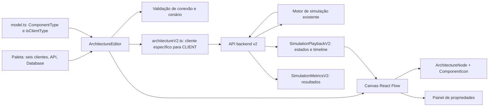
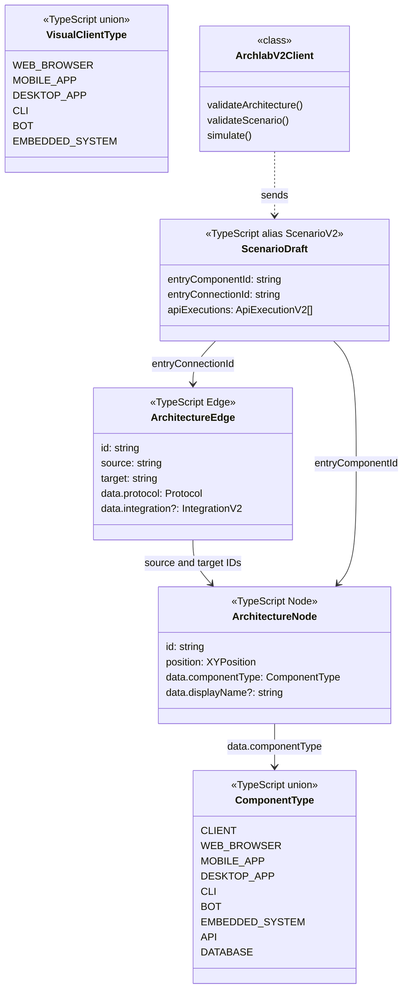

# Defesa técnica — clientes funcionais v0.3 (Errata 01)

## Contexto e escopo

FE-01 a FE-06 seguiram a decisão inicial do ADR v0.3: seis clientes específicos apenas para modelagem visual, sem conexões nem simulação. A [Errata 01](../requirements/v0.3-errata-client-behavior.md) substituiu essa restrição ao estabelecer que os seis podem compartilhar o comportamento funcional do `CLIENT` existente. FE-07 a FE-11 corrigem a entrega na mesma branch e no mesmo PR #78. O editor continua distinguindo Web Browser, Mobile App, Desktop App, CLI, Bot e Embedded System; o contrato v2 recebe `CLIENT` para cada um.

## Decisões de engenharia

- O tipo específico permanece em `ArchitectureNode.data.componentType`. A paleta declara apenas os seis tipos novos em Clientes; o tipo `CLIENT` genérico continua na união TypeScript para cenários legados e no contrato v2, mas não pode ser criado pela paleta.
- `isClientType` em `model.ts` agrupa o tipo legado e os seis novos somente para regras compartilhadas. `allowedProtocols` aplica o par cliente → API com REST/SOAP; `allowedIntegrationKinds` aplica HTTP_REST/SOAP_HTTP. Duplicidade, direção e ciclos continuam sob `validateConnection` e a validação de grafo existente. Não há seis cópias das regras.
- `scenario.ts` e `ScenarioEditor.tsx` aceitam os sete identificadores de cliente como origem, mantendo o ID original na seleção e nas conexões. Isso permite a resposta do backend ser correlacionada por ID ao nó do frontend.
- `architectureV2.ts` é a fronteira escolhida para adaptar o tipo. Ele serializa cada cliente como `CLIENT` sem alterar `id`, `displayName` ou o estado dos nós; API, Database e conexões continuam no formato atual. A validação e a simulação usam o mesmo adaptador. O motor Java e OpenAPI permanecem intactos porque já conhecem o comportamento necessário.
- `ArchitectureEditor.tsx` removeu a proteção local da implementação inicial. Ao escolher SOAP na criação, inicializa a integração SOAP_HTTP; ao mudar o protocolo de uma conexão, ajusta a integração padrão se necessário. Uma integração editada manualmente é preservada quando o protocolo não muda. A timeline, o estado e as métricas já usam os IDs retornados e não precisam de bifurcação por subtipo.
- Ícones, nomes, posição, seleção, movimentação, renomeação e remoção permanecem associados ao nó original. O componente `ComponentIcon` e o nó visual não consultam o tipo funcional serializado.

### Alternativas rejeitadas

Reescrever os nós locais como `CLIENT` apagaria a identidade visual. Criar um motor ou regras separadas para cada subtipo duplicaria a lógica. Ampliar o enum e os DTOs v2 exigiria mudança de backend sem novo comportamento. Ocultar a conversão dentro do editor misturaria estado de apresentação e contrato; a serialização concentra essa responsabilidade.

## Arquitetura



## UML das estruturas reais

`ComponentType`, `VisualClientType`, `ArchitectureNode`, `ArchitectureEdge` e `ScenarioDraft` são tipos TypeScript; não há classes de herança entre clientes. `isClientType`, `reconcileScenario` e `toArchitectureV2` são funções. `ArchlabV2Client` é uma classe real.



## Sequência de simulação

```mermaid
sequenceDiagram
    actor U as Usuário
    participant P as Paleta
    participant E as ArchitectureEditor
    participant M as model.ts
    participant A as architectureV2.ts
    participant B as Backend v2
    participant S as Motor de simulação
    participant T as Playback e métricas
    U->>P: Adiciona Web Browser
    P->>E: WEB_BROWSER e posição
    E->>M: createArchitectureNode
    M-->>E: Nó com tipo WEB_BROWSER e ID próprio
    U->>E: Conecta Web Browser a API via REST/SOAP
    E->>M: validateConnection e createArchitectureEdge
    M-->>E: Conexão com IDs originais
    U->>E: Seleciona cliente e conexão de entrada
    U->>E: Clica Simular
    E->>A: toArchitectureV2(nodes, edges)
    A-->>E: Payload com type CLIENT, mesmos IDs e nomes
    E->>B: validateScenario(payload)
    B-->>E: valid
    E->>B: simulate(payload)
    B->>S: Executa fluxo CLIENT → API
    S-->>B: Trace, estados, timeline e métricas
    B-->>E: SimulationResponseV2 com IDs originais
    E->>T: Exibe resposta e correlaciona IDs aos nós
    T-->>U: Timeline, estados e resultados; nó segue WEB_BROWSER
```

O mesmo fluxo se aplica aos outros cinco tipos. A dependência API → Database usa a regra existente; quando não selecionada, a API responde diretamente.

## Rastreabilidade

| Errata / requisito | Tarefa | Arquivos principais | Testes | Resultado |
| --- | --- | --- | --- | --- |
| RF-01, RF-08, RF-11 | FE-07 | `ArchitectureEditor.tsx` | `App.test.tsx` paleta | Somente seis clientes na categoria |
| RF-09 | FE-08 | `model.ts`, `integration.ts` | `model.test.ts`, `integration.test.ts`, `App.test.tsx` | REST/SOAP para cliente → API; pares inválidos recusados |
| RF-07, RF-10 | FE-09 | `architectureV2.ts`, `scenario.ts`, `ScenarioEditor.tsx`, `ArchitectureEditor.tsx` | `architectureOverrideV2.test.ts`, `scenario.test.ts`, `App.test.tsx` | Tipo visual preservado; payload CLIENT com IDs e nomes |
| RF-02–RF-06, RF-09–RF-10, RQ-02 | FE-10 | `App.test.tsx`, `ArchitectureEditor.tsx` | seis fluxos com API/Database, regressão v0.2, suíte completa | Aprovado em testes de frontend |
| Justificativa e diagramas | FE-11 | este documento | revisão do diff e comandos finais | Documentado |

## Testes e evidências

Executados em `frontend` após FE-10:

| Comando | Resultado |
| --- | --- |
| `npm test` | 17 arquivos, 137 testes aprovados |
| `npm run lint` | Aprovado |
| `npm run build` | TypeScript e Vite aprovados |
| `npm run test:integration` | Falhou: `EACCES` ao conectar em `localhost:8080`; o script disponível cobre API v1 e depende de backend ativo |

Os testes com MSW verificam chamadas reais do frontend às rotas v2 interceptadas, o payload adaptado, seleção de cenário, integração REST/SOAP, retorno do snapshot, timeline, métricas e manutenção do tipo no nó. MSW simula a resposta do servidor; não prova uma execução Java de ponta a ponta. O teste de drag-and-drop usa canvas simulado em jsdom. A validação manual em navegador com backend ativo integra a revisão do PR.

## Riscos e limites

- A identidade específica existe no frontend, mas o backend v2 recebe `CLIENT`. Consumidores que lerem apenas o payload ou os resultados v2 não distinguirão os seis subtipos; a correlação depende dos IDs preservados.
- O contrato e o modelo visual podem divergir se novos campos especializados forem introduzidos futuramente. Essa evolução exige decisão explícita de contrato.
- SOAP e REST utilizam o comportamento ilustrativo já existente. Navegador real, SDK mobile, automação de Bot, sensores e novos protocolos continuam fora do escopo.
- O teste com backend real não foi concluído nesta sessão porque não havia conexão permitida com `localhost:8080`. O responsável deve executar o roteiro manual com serviço ativo.

## Revisão final

As mudanças da errata estão restritas ao frontend, aos testes e a este documento. A branch conserva os commits da implementação inicial para rastreabilidade; os commits FE-07 a FE-11 corrigem as decisões substituídas pela Errata 01. Não houve alteração de backend, motor Java, OpenAPI ou dependências.
