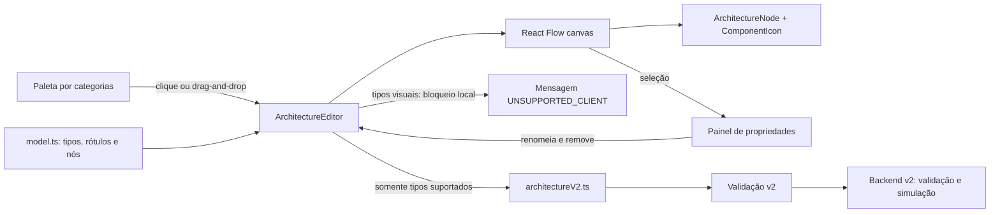
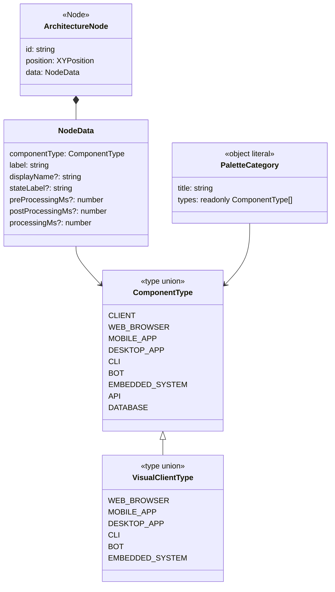
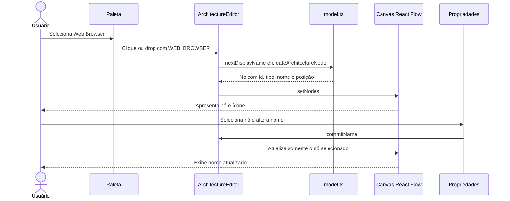
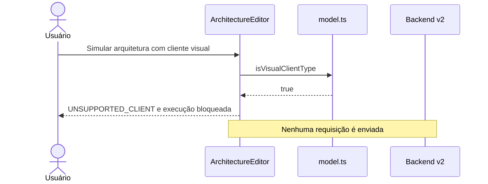

# Defesa técnica — catálogo visual de clientes v0.3

## Resumo e requisitos

A entrega implementa RF-01 a RF-08: seis tipos distintos de clientes no modelo local e na paleta, criação por clique ou arrastar, seleção, movimentação, renomeação e remoção por meio das operações existentes do React Flow, nomes e ícones próprios e organização em Clientes, Serviços e Dados. Os seis tipos são exclusivamente visuais. O `CLIENT` genérico permanece disponível na categoria Clientes para preservar a criação e a simulação dos cenários v0.2 existentes; API e Database permanecem em Serviços e Dados.

## Decisões técnicas

- `model.ts` concentra a união de tipos, os rótulos e o predicado `isVisualClientType`. A mesma estrutura `ArchitectureNode` armazena id, posição e dados de cada novo tipo. `crypto.randomUUID` mantém ids independentes; `nextDisplayName` evita colisões de nomes automáticos. Isso evita subclasses e um segundo estado de editor. A alternativa de representar todos os novos clientes como `CLIENT` foi rejeitada porque apagaria sua identidade.
- `ArchitectureEditor.tsx` define as três categorias em dados declarativos e reutiliza os handlers existentes de clique e drag-and-drop. Mantém o `CLIENT` genérico acessível para não quebrar os cenários atuais. Não há novos controles de propriedades nem comportamento de colapso. O editor consulta `isVisualClientType` antes de qualquer validação ou simulação v2; uma violação local `UNSUPPORTED_CLIENT` informa o tipo ao usuário.
- `ComponentIcon.tsx` mapeia cada tipo para Lucide; `ArchitectureNode.tsx` reutiliza o ícone e exibe o rótulo legível. `style.css` aplica o padrão de cor de clientes e rolagem na paleta para os novos itens nos temas atuais. Criar componentes de nó separados aumentaria manutenção sem necessidade.
- `architectureV2.ts` rejeita arquiteturas com clientes visuais antes de montar a requisição e mantém um `default` defensivo no switch. Isso impede coerção para `CLIENT`, perda silenciosa de componentes e chamadas incompatíveis. O modelo v2 e o backend ficam inalterados. Conexões envolvendo os seis tipos são recusadas em `validateConnection`; os protocolos dos tipos existentes continuam válidos.
- A edição usa as operações já existentes de React Flow e do painel de propriedades. FE-04 exigiu testes de cobertura, sem nova lógica de produção. O estado permanece local; persistência e execução dos clientes visuais dependem de versão futura.

## Arquitetura da solução

## UML das estruturas presentes

Os tipos abaixo representam aliases e objetos TypeScript, sem sugerir classes de runtime.

## Sequências

## Testes e evidências

Na branch `feat/frontend-v0.3-client-catalog`, em `frontend`:

| Comando | Resultado |
| --- | --- |
| `npm test` | 17 arquivos, 114 testes aprovados |
| `npm run lint` | Aprovado, sem erros |
| `npm run build` | TypeScript e Vite aprovados |

`model.test.ts` cobre criação, id, nomes automáticos e bloqueio de conexão dos seis tipos. `ComponentIcon.test.tsx` cobre os nove mapeamentos de ícone. `App.test.tsx` cobre categorias, inclusão por clique e drag-and-drop, seleção, movimentação, renomeação, remoção, múltiplas instâncias e ausência de chamadas v2 em validação/simulação bloqueadas. `architectureOverrideV2.test.ts` cobre a rejeição de serialização dos seis tipos. Testes preexistentes cobrem o fluxo de conexão, validação e simulação dos tipos legados. O teste de drag-and-drop usa um canvas simulado em jsdom; a inspeção visual em navegador real fica para a revisão do PR.

## Riscos e limitações

- Cenários que contenham qualquer cliente visual não podem ser validados nem simulados pelo backend v2, inclusive quando também contenham componentes legados. A mensagem local explicita o bloqueio.
- Os novos clientes não podem formar conexões. Perfis, estímulos e execução permanecem no backlog.
- O estado do editor não é persistido. A paleta mantém `CLIENT` legado para preservar o fluxo v0.2; sua distinção dos seis clientes visuais deve ser mantida até migração deliberada.
- A verificação visual manual em navegador real ainda cabe ao responsável pela revisão.

## Rastreabilidade e verificações do ADR

| Requisito | Tarefa | Arquivos | Testes | Resultado |
| --- | --- | --- | --- | --- |
| RF-01 | FE-01/02 | `model.ts`, `ArchitectureEditor.tsx` | `model.test.ts`, `App.test.tsx` | Seis tipos disponíveis |
| RF-02 | FE-02/06 | `ArchitectureEditor.tsx` | `App.test.tsx` clique e drag-and-drop | Aprovado |
| RF-03 | FE-04 | fluxo existente do editor | `App.test.tsx` movimento e seleção | Aprovado |
| RF-04 | FE-04 | painel existente em `ArchitectureEditor.tsx` | `App.test.tsx` renomeação | Aprovado |
| RF-05 | FE-04 | `model.ts`, `ArchitectureEditor.tsx` | `App.test.tsx` remoção isolada | Aprovado |
| RF-06 | FE-03 | `ComponentIcon.tsx`, `ArchitectureNode.tsx` | `ComponentIcon.test.tsx` | Nove ícones verificados |
| RF-07 | FE-01/04 | `model.ts` | `model.test.ts`, `App.test.tsx` | Id, tipo, nome e posição preservados |
| RF-08 | FE-02 | `ArchitectureEditor.tsx`, `style.css` | `App.test.tsx` categorias | Aprovado |
| RQ-01 simplicidade | FE-01–05 | modelo e editor existentes | revisão do diff | Sem backend ou dependências novas |
| RQ-02 estabilidade | FE-04/06 | fluxo existente | suíte completa, 114 testes | Aprovado |
| RQ-03 coerência visual | FE-02/03 | ícones e estilos existentes | testes de ícones e editor | Aprovado |
| RQ-04 tipagem | FE-01/06 | `model.ts` | testes do modelo, `npm run build` | Aprovado |
| RQ-05 não executável | FE-05 | `model.ts`, `ArchitectureEditor.tsx`, `architectureV2.ts` | testes de conexão, serialização e ausência de chamadas | Aprovado |

O diff contra `origin/develop` foi verificado com `git diff --check`; não há alteração de backend, contrato OpenAPI, motor ou dependências. FE-01 a FE-06 foram registradas em commits separados e enviados à mesma branch.
