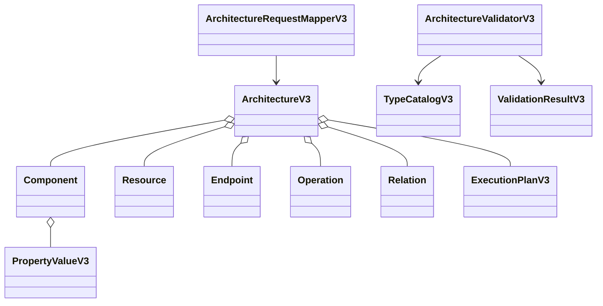
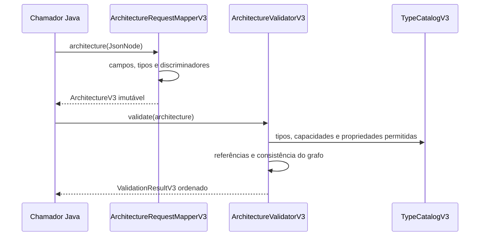

# BE-V3-02 — Modelo tipado de arquitetura

Base: develop 3df2b74, incluindo ADR-v0.3.md. Fonte estrutural: openapi-v3.yaml.
O ADR consolidado indicado pelo usuário permite retomar o trabalho; a lacuna anterior
não bloqueia as decisões técnicas registradas abaixo. Não afirmar transcrição literal
ou conformidade histórica com documentos ainda não incorporados ao repositório.

## Implementação e aceite

- PropertyValueV3: oito variantes fechadas, listas/objetos imutáveis, limites de schema,
  decimal textual sem perda de precisão e referências com tipo esperado.
- ArchitectureV3: componentes, recursos, endpoints, operações e bindings, relações
  estruturais/de comunicação e planos tipados. Tipos dos nove steps preparados para 03.
- InitialStateV3: COMPONENT, RESOURCE, POLICY e QUEUE; campos opcionais preservam ausência.
- ArchitectureRequestMapperV3: decoder estrito, rejeita campos desconhecidos, coerção,
  int64 fora de faixa, discriminadores inválidos e ausência indevida de campos.
- ArchitectureValidatorV3: erros ordenados por entidade/posição de entrada e chave de
  propriedade ordenada; IDs globais, referências, donos, endpoints/protocolos,
  capacidades, bindings/plano e propriedades por catálogo.
- Estado inicial: referências, duplicatas por tipo/ID e contagem inicial <= capacidade.
- Catálogo extensível e controlado pelo servidor. Não deriva regras de propriedades
  arbitrárias recebidas do cliente. Catálogo declarado não é handler de execução.

## Decisões concretas do catálogo inicial

O YAML deixa typeId, protocolProfileId e capacidades como identificadores abertos.
CLIENT_GENERIC e API_SERVICE vêm da fixture publicada; os quatro IDs adicionais abaixo
são decisões explícitas desta implementação, substituíveis por novos registros de catálogo.

| Tipo | Propriedades | Capacidades | Native behavior |
|---|---|---|---|
| CLIENT_GENERIC | available BOOLEAN | CALL, DELAY, COMPLETE, FAIL | nenhum |
| API_SERVICE | available BOOLEAN | os nove steps | nenhum |
| DATABASE_GENERIC | available BOOLEAN, processingMs INTEGER >= 0 | PROCESS, COMPLETE, FAIL | DATABASE_QUERY |
| BROKER_GENERIC | available BOOLEAN, processingMs INTEGER >= 0 | PUBLISH, COMPLETE, FAIL | BROKER_ACCEPT |
| QUEUE_GENERIC | available BOOLEAN | COMPLETE, FAIL | QUEUE_DELIVER |
| TELEMETRY_GENERIC | available BOOLEAN, processingMs INTEGER >= 0 | PROCESS, COMPLETE, FAIL | TELEMETRY_COLLECT |

Recursos: PROCESSING_POOL (API/Database/Telemetry; capacity, available),
MESSAGE_QUEUE (Queue; capacity, ttlMs) e TOPIC (Broker; sem propriedades).
Comunicação admite latencyMs INTEGER >= 0. Endpoints e relações estruturais não têm
propriedades adicionais nesta fatia. Protocolos registrados: HTTP_REST, SOAP_HTTP,
DATABASE_QUERY, MESSAGING e TELEMETRY. A compatibilidade detalhada por tipo de protocolo
será expandida junto aos handlers; o validador já exige igualdade entre os endpoints
participantes e o protocolo da relação.

Política inicial exige recurso POLICY_INSTANCE existente; o catálogo padrão não declara
esse recurso. Assim, políticas não implementadas são rejeitadas, nunca aceitas silenciosamente.
Profundidade máxima de propriedades/condições no decoder: 64, limite operacional provisório.
O parser não envia mensagens reais nem executa código contido nas propriedades.

## UML do código entregue

## Evidências reais

JDK 25.0.4.1, Spring Boot 4.0.8; core continua sem dependências adicionais.
No diretório backend: `mvnw.cmd -B clean verify`.
Resultado: BUILD SUCCESS, 122 testes core e 46 API, zero falhas/erros/ignorados.
39 novos casos em relação ao bootstrap. Fixture architecture-simple.json decodificada
e validada com o core real. Regressões v1/v2 existentes e RF-044 continuam passando.
Log completo local: C:/Users/valde/Documents/ChatGPT/ArchLab/logs/be-v3-02-verify.log.

Não implementa interpretação dos steps, scheduler, handlers, replay ou endpoints v3.
Esses critérios pertencem aos cards seguintes e permanecem pendentes.
