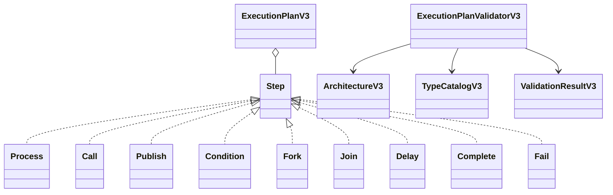
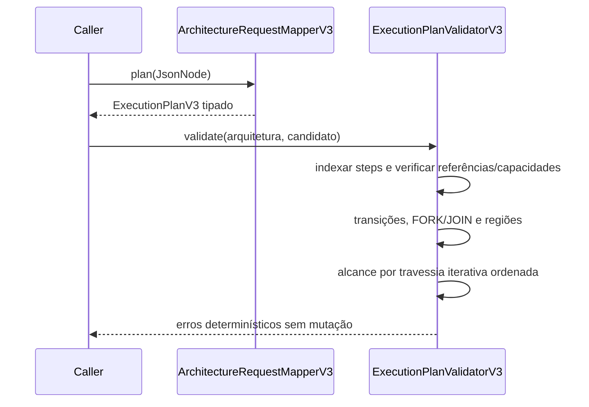

# BE-V3-03 — Validação de ExecutionPlan

Referências: ADR-v0.3.md (019, 020, 025), openapi-v3.yaml.

## Regras implementadas

- Candidato validado no contexto da arquitetura, sem modificar o plano armazenado.
- IDs de steps e branches únicos; entryStepId e todos os destinos existentes.
- Steps efetivos compatíveis com capacidades do componente dono da operação.
- PROCESS só admite NEXT e recurso PROCESSING_POOL do mesmo dono, quando declarado.
- CALL verifica relação de comunicação, dono da origem, operação anunciada no endpoint
  destino e policyRef de tipo POLICY_INSTANCE, quando declarado.
- CALL NONE admite DISPATCHED/FAILURE; RESPONSE admite SUCCESS, BUSINESS_REJECTION,
  FAILURE, TIMEOUT e CANCELLED. A transição normal é obrigatória.
- PUBLISH exige recurso MESSAGE_QUEUE/TOPIC; NONE admite DISPATCHED/FAILURE;
  modos de ACK admitem ACCEPTED/SUCCESS/REJECTED/FAILURE/TIMEOUT/CANCELLED, com
  pelo menos ACCEPTED ou SUCCESS. Política declarada deve existir e ter tipo correto.
- JOIN admite SATISFIED/UNSATISFIABLE/TIMEOUT/CANCELLED e exige SATISFIED.
  Políticas ALL/ANY/FIRST_SUCCESS/QUORUM; quorum exclusivo de QUORUM, positivo e
  não superior ao número de branches requeridos distintos.
- Cada FORK aponta um JOIN; cada JOIN pertence a um único FORK; branches requeridos
  pertencem ao FORK, sem duplicação. Regiões de branches irmãos não podem se sobrepor.
- COMPLETE/FAIL BRANCH terminam branches; não são terminais do fluxo principal.
  COMPLETE/FAIL ACTIVATION não encerram branches isolados nesta fatia estruturada.
- FORKs aninhados permitidos; branches não escapam para a continuação principal.
- Steps inalcançáveis são erros. Ciclos são permitidos, com limites positivos finitos
  maxStepExecutions/maxIterations; a aplicação desses limites é obrigação do runtime.
- Condições são dados tipados, sem execução de código; decoder suporta compare,
  EXISTS, AND/OR e NOT, operandos literais/referências e erro explícito de shape.

As regras de transição/região acima são decisões explícitas de implementação a partir
do ADR consolidado e dos campos do YAML. Não representam recuperação literal de EP-V3-001.
Resultados/profileIds e input/outputContractIds referenciam perfis externos ao grafo do
YAML atual; não são tratados falsamente como IDs de componentes.

## UML e sequência

## Evidências

JDK 25.0.4.1, `mvnw.cmd -B clean verify` no diretório backend: BUILD SUCCESS,
138 testes core + 64 API = 202 testes, zero falhas/erros/ignorados.
34 casos novos: nove steps positivos e negativos no decoder, quatro políticas JOIN,
quorum impossível, referências/IDs/entry inválidos, overlap/escape, FORK aninhado,
ciclos sem travessia infinita, limites, capabilities e estabilidade dos erros.
Regressões v1/v2/RF-044 preservadas. Nenhuma dependência nova ou alteração do legado.
Log local: C:/Users/valde/Documents/ChatGPT/ArchLab/logs/be-v3-03-verify.log.

O interpretador e a aplicação dos limites em execução continuam nos cards 07/08;
BE-V3-03 não declara simulação funcional apenas por validar os dados.
