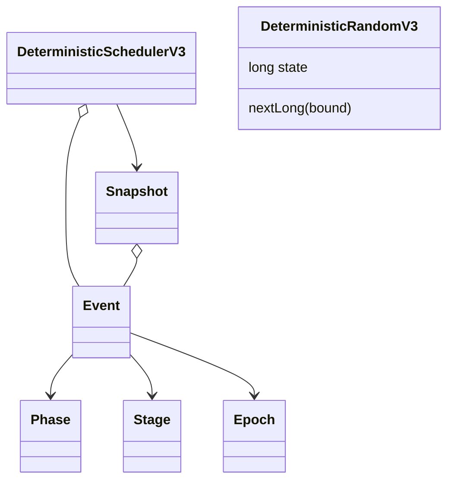
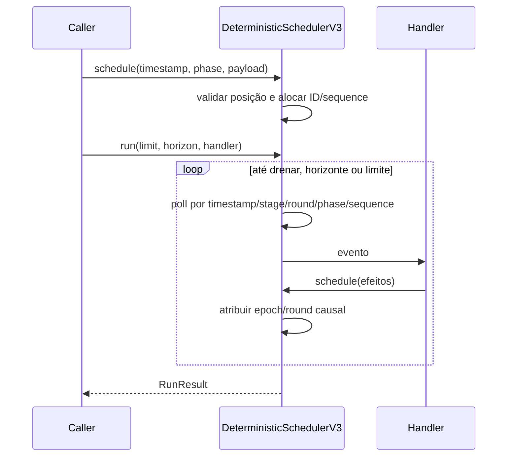

# BE-V3-04 — Scheduler virtual determinístico

Referências: ADR-v0.3.md (021, 027), envelopes/posições de scheduler do OpenAPI.
Implementação Java puro: DeterministicSchedulerV3<T>, DeterministicRandomV3.

## Ordem e causalidade

Fases: ENVIRONMENT_CHANGE=0, DELIVERY_OR_COMPLETION=10, CONTINUATION=20,
DEADLINE=30, TERMINATION_CHECK=40. Ordem total: timestamp, stage, round, phase,
sequence. IDs event-N e sequência monotônica com overflow explícito.

Stages: ENVIRONMENT, BEFORE_DEADLINES, DEADLINES, AFTER_DEADLINES, TERMINATION.
Um efeito com fase menor que sua causa, no mesmo stage/tempo, entra no próximo round.
Isso impede que uma conclusão de duração zero seja executada antes da continuação
que a criou. O ponto fixo anterior a deadlines é drenado antes da barreira DEADLINES.
Efeitos de delivery/continuation gerados por deadline entram em AFTER_DEADLINES;
não preemptam outros deadlines já devidos. Deadlines derivados de um deadline ficam
na barreira DEADLINES em sequência posterior; deadlines derivados da fase AFTER ficam
nessa fase e respeitam seus rounds. Termination só executa após os demais stages.

Mudanças de ambiente derivadas depois da barreira de ambiente e efeitos de fases
anteriores derivados de termination no mesmo timestamp são rejeitados. Eventos em
outro timestamp reiniciam stage/round/epoch. causationEventId preserva a causa.
Essas regras são decisões concretas sobre o ADR consolidado e o envelope do YAML;
não são apresentadas como transcrição literal do documento SCH original ausente.

## Execução e restauração

- run limita dispatches, preserva eventos pendentes e retorna DRAINED/HORIZON/EVENT_LIMIT.
- Horizonte inclusivo: eventos exatamente no horizonte executam; futuros permanecem
  na agenda. Se drenar antes, retorna DRAINED no tempo real virtual do último evento.
- O relógio nunca retrocede; não há relógio de parede ou espera de threads.
- Snapshot imutável preserva relógio, nextSequence, último dispatch e agenda ordenada.
  Restore valida IDs/contadores/duplicatas/posição e permite continuar a mesma agenda.
- O RNG usa estado explícito restaurável; mesma seed gera o mesmo fluxo. A ordenação
  do scheduler não utiliza aleatoriedade. Payloads devem ser valores imutáveis.
- O callback de run não é transação: atomicidade entre scheduler e runtime pertence
  ao dispatcher/EffectBatch do BE-V3-06. O snapshot da agenda isolada não é alegado
  como FULL_RUNTIME da simulação completa, que pertence aos cards 05/06/09.

## Evidências reais

JDK 25.0.4.1, `mvnw.cmd -B clean verify`: BUILD SUCCESS; 149 core + 64 API =
213 testes, zero failures/errors/skipped. Onze novos testes cobrem as cinco fases,
desempate estável, duração zero/rounds, barreira de deadlines, epoch posterior,
horizonte inclusivo/resume, horizonte sem evento, limite com ciclo zero, snapshot/restart,
entradas inválidas/overflow sem mutação e RNG com mesma seed/estado restaurado.
Regressões v1/v2/RF-044 preservadas. Busca no código v3 não encontrou Thread.sleep,
currentTimeMillis, nanoTime, java.time.Clock ou Instant.now.
Log local: C:/Users/valde/Documents/ChatGPT/ArchLab/logs/be-v3-04-verify.log.
