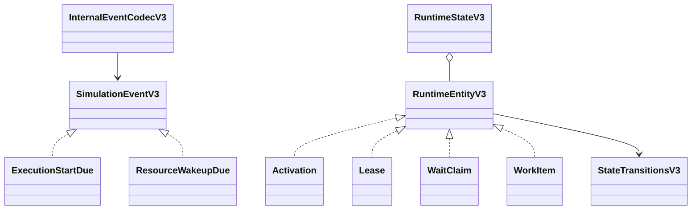
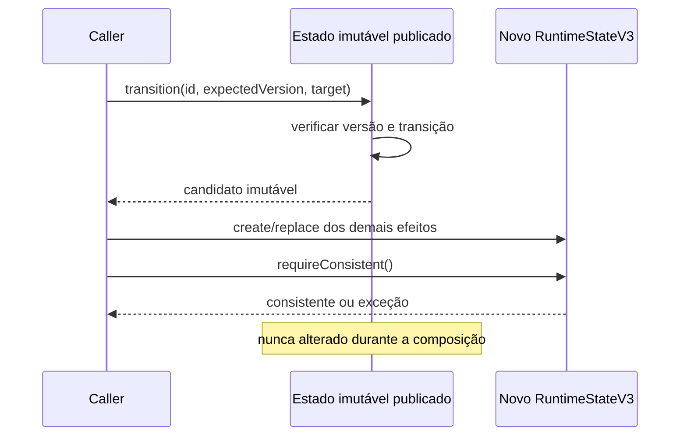

# BE-V3-05 — Estados runtime e 32 payloads internos

Referências: ADR-v0.3.md (022, 023, 027), schemas EC/runtime do OpenAPI v3.

## Implementação

SimulationEventV3 é uma união sealed de exatamente 32 records Java, com catálogo enum
fechado e discriminador eventType. Campos exigidos são tipados como IdentifierV3,
DurationMsV3, RuntimeEntityRefV3 ou long com mínimo explícito. Não incluem metadados
indevidamente no payload: tempo/fase/sequence/epoch permanecem no envelope do scheduler.
InternalEventCodecV3 mantém JSON fora do core e faz roundtrip sem coerção, rejeitando
campos desconhecidos, ausentes, discriminadores inválidos e versões/ordinais negativos.

RuntimeEntityV3 modela 21 variantes imutáveis, incluindo os oito snapshots públicos,
cursores, timers, claims/leases, work, policies, resultados, agenda/counters e estados
internos de Component, Principal e StepExecution. Versões são obrigatórias no core,
mesmo quando opcionais na representação pública. Recursos impõem 0 <= inUse <= capacity.
Listas são copiadas e campos obrigatórios não admitem null.

StateTransitionsV3 contém tabelas explícitas para os ciclos nativos de ativação,
interação, tentativa, grupo paralelo, fila, publicação, entrega, cursor/branch, timer,
lease, claim, work, component, principal e step. Estados terminais não reabrem;
redelivery permite IN_DELIVERY -> READY para QueueEntry. Estados de recurso nativos:
AVAILABLE/EXHAUSTED/UNAVAILABLE. Essas escolhas são decisões da implementação sobre
o ADR consolidado; não são alegadas como texto recuperado de EV-V3-001.

PolicyState preserva texto de estado, mas não admite transições nativas arbitrárias:
o catálogo inicial não declara policies executáveis. Eventos POLICY_TRANSITION_DUE
existem como payloads; isso não representa handler funcional nem suporte de políticas.
STEP_RESULT, SCHEDULED_EVENT e ID_COUNTER são dados versionados sem ciclo de status.

RuntimeStateV3 é um valor persistente: create/replace/transition retornam outro estado,
validam identidade/tipo/versão e não alteram o estado publicado. requireConsistent valida
referências e vínculos de attempts, branches, claims, leases, recursos e work; soma das
leases HELD deve corresponder a inUse. Um claim não pode receber duas leases. Candidatos
podem ser compostos localmente e só devem ser publicados após a validação completa pelo
EffectBatch (card 06). Não há singleton mutável ou dependência Spring no core.

## Geradores e fixtures

32 fixtures em docs/examples/v3/events. Geradores opcionais em tools/generate-events-v3.cjs
e tools/generate-runtime-v3.cjs leem o YAML; não são dependência do build Java.
Execução: node <gerador> <raiz-do-repo> <caminho-do-módulo-yaml>.
O segundo gerador requer os argumentos explícitos. Saídas Java e fixtures são versionadas.

## Diagramas

## Evidências reais

JDK 25.0.4.1: mvnw.cmd -B clean verify passou com 154 core + 97 API = 251 testes,
zero failures/errors/skipped. Inclui 32 roundtrips completos, catálogo sealed de tamanho
32, rejeição de 96 mutações de campos/discriminadores e mínimos numéricos, além de cinco
testes de lifecycle/versões/imutabilidade/invariantes. v1/v2/RF-044 preservados.
Verificação independente Ajv 2020-12 contra SimulationEventPayloadV3 do YAML: 32 fixtures
aceitas e 96 mutações rejeitadas. Isso complementa, não substitui, os testes Java.
Log: C:/Users/valde/Documents/ChatGPT/ArchLab/logs/be-v3-05-verify.log.

Adicionado workflow backend-ci.yml com JDK Temurin 25 e clean verify, disparado por
backend/contrato/fixtures; o workflow OpenAPI existente também será aplicável neste PR.
Os 32 handlers de execução, atomicidade do dispatcher, snapshot FULL_RUNTIME completo
e replay funcional permanecem nos cards 06–09. Este card entrega modelo e invariantes.
