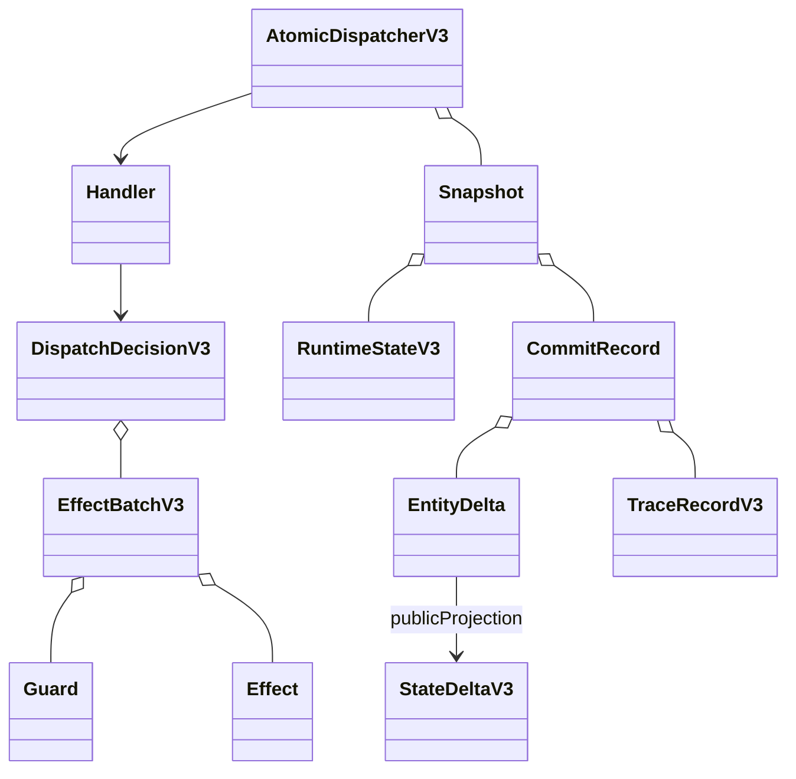
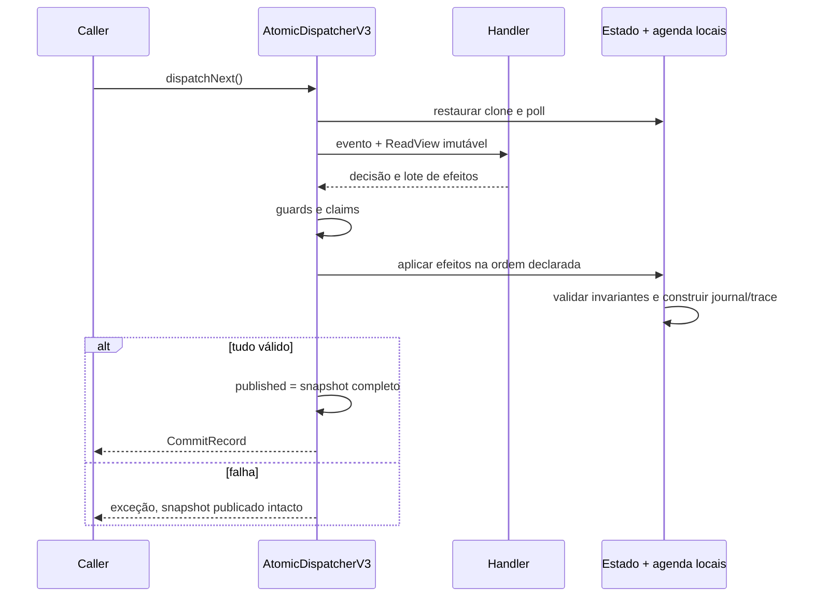

# BE-V3-06 — Dispatcher e EffectBatch atômico

Referências: ADR-v0.3.md (024, 027), StateDelta/TraceRecord do OpenAPI v3.

## Comportamento entregue

AtomicDispatcherV3 recebe handlers de domínio por tipo de evento. Não fornece handler
no-op implícito: tipo sem handler falha e mantém o evento pendente. O mapa pode ser
parcial durante a construção do interpretador, que pertence aos cards 07/08.

Pipeline: agenda publicada -> clone local/poll -> handler com ReadView imutável ->
DispatchDecisionV3 -> guards/claims -> efeitos ordenados -> invariantes -> publicação
única de Snapshot imutável. A referência publicada é volatile; dispatch é serializado
e reentrância é rejeitada. Nenhum efeito contém callback executável.

Efeitos: Create, Replace com versão esperada, Transition, Remove, Schedule, TakeClaim,
AdvanceRandom com estado esperado e Emit. Create/Replace/Transition alimentam deltas
com before/after exatos; Remove impede exclusão de entidade ativa e a validação final
impede referências pendentes. IDs removidos não podem ser reutilizados nesta execução.
Agendamentos usam o clone real do scheduler e preservam seus counters/causalidade.

Guards de versão, estado e ausência de claim podem consumir um evento obsoleto como
Ignore sem aplicar efeitos. Claim já tomado pelo mesmo owner/purpose ignora o lote;
owner/purpose conflitantes falham. Claims duplicados no mesmo lote só são aceitos se
idênticos. A falha de qualquer efeito/invariante não altera estado, agenda, IDs, claims,
RNG, trace ou journal publicados; o evento original permanece pendente.

## Trace, deltas e journal

TraceRecordV3 contém catálogo de 38 kinds públicos e 11 variantes de detail, com
validação dos pares kind/detail/action conforme as condições do YAML. Context mantém
sourceEventId; dispatcher rejeita um Emit com sourceEventId diferente do evento atual.
Os geradores opcionais usam YAML somente durante manutenção, fora do build Java.

Cada commit emite SCHEDULER_POSITION_CHANGED. Efeitos Emit produzem fatos de negócio
explícitos. Cada mutação tem EntityDelta interno com ID/sequence, timestamp, referência
a um TraceRecord do commit e before/after. publicProjection filtra estritamente os oito
tipos públicos admitidos por StateDeltaV3. Entidades internas (incluindo Component,
Principal e StepExecution) não são serializadas indevidamente nessa união pública.
Deltas públicos impõem CREATE versão zero, UPDATE +1 e REMOVE com nextVersion null.

O journal guarda a decisão e os efeitos como valores, permitindo reaplicar commits
pelo mesmo pipeline de efeitos e comparar o resultado calculado ao registro esperado.
O checkpoint interno inclui estado, agenda, RNG, counters, claims, trace e journal.
Restauração valida contadores, origem/ordem de trace, before/after, IDs e estado final
contra o histórico. O perfil atual retém todo o histórico; não declara suporte a
journal truncado. Replay de efeitos não equivale a reexecutar handlers de negócio.
FULL_RUNTIME no formato HTTP, métricas, projeção/codec e replay de cenários completos
permanecem no card 09; os quatro endpoints permanecem no card 10.

## UML e sequência reais

## Evidências

JDK 25.0.4.1, mvnw.cmd -B clean verify: BUILD SUCCESS, 168 core + 97 API = 265
testes sem failures/errors/skipped. Quatorze casos novos cobrem publicação, falha tardia,
invariante final, guards, claims repetidos/conflitantes, reentrância, handler ausente,
trace inválido, causalidade, replay exato/rejeitado, remoção/ID, ordem de efeitos,
resolução de work e checkpoint inconsistente. Testes usam scheduler/runtime reais.
v1/v2/RF-044 preservados. Log: C:/Users/valde/Documents/ChatGPT/ArchLab/logs/be-v3-06-verify.log.

Escolha de implementação: cópias persistentes simples e histórico completo facilitam
atomicidade/revisão nesta fatia; não há evidência de benchmark ou otimização para
execuções grandes. Os limites operacionais e benchmarks serão avaliados no aceite final.
