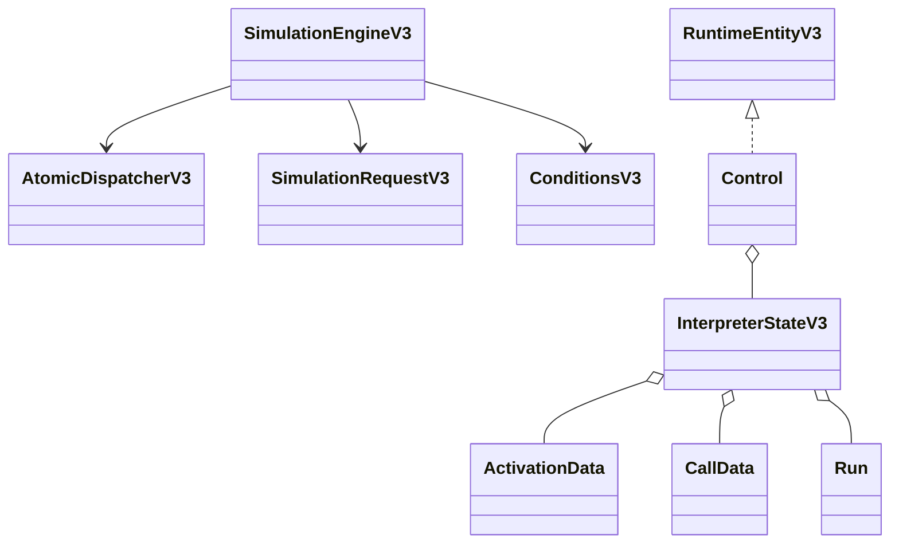
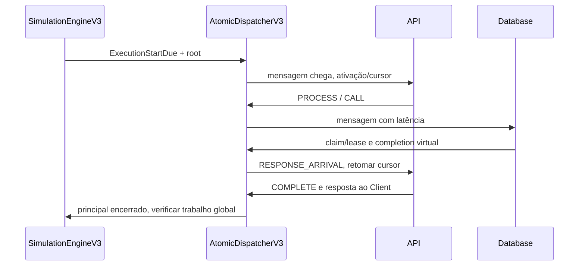

# BE-V3-07 — Interpretador síncrono

ADR-v0.3.md (020–027) e OpenAPI são as referências. Implementação sobre o scheduler
e dispatcher reais, sem Spring, rede ou estado mutável retido nos handlers.

PROCESS, CALL, CONDITION, DELAY, COMPLETE e FAIL agora executam. Chamadas geram
interactions/attempts/mensagens de ida/volta com latência e correlação; RESPONSE bloqueia
o cursor/ativação e NONE mantém trabalho global independente. Database nativo realiza
processamento e usa o primeiro PROCESSING_POOL próprio por ID, se configurado.

Contexto de operação, vínculos de retorno, runs, contadores e métricas parciais ficam
em InterpreterStateV3 imutável, na entidade interna CONTROL; alterações entram no mesmo
EffectBatch. Checkpoint inclui pedido, snapshot inicial e snapshot atual. Resume não
usa coleções ocultas em closures. CONTROL não é projeção pública; sua representação
externa FULL_RUNTIME será resolvida no BE-V3-09, sem fingir que cabe no schema anterior.

## Decisões e regras

- Limites maxStepExecutions por ativação e maxIterations por visita de step; orçamento
  global de 100.000 dispatches. Excesso termina com LIMIT_REACHED, preservando trabalho.
- PROCESS com recurso utiliza claim/lease FIFO; liberação ocorre antes da continuação
  por fase causal. Cancelamento libera leases e rejeita claims ainda em espera.
- POLICY_INSTANCE inicial aceita timeoutMs INTEGER >= 0, pertencente a API/Client.
  CALL.policyRef usa esse timeout. Relação COMMUNICATION admite timeoutMs para o root.
  Isso substitui a ausência de policies executáveis registrada no card 02 para esta
  política concreta. Outras políticas não ganham suporte implícito.
- Completions/respostas no instante do deadline vencem pela barreira do scheduler.
  Timers cancelados não prolongam a duração global; eventos tardios não reabrem estados.
- Timeout cancela a ativação remota e propaga cancelamento aos CALLs aguardados filhos.
  CALL NONE não é cancelado apenas porque o chamador respondeu.
- CONDITION interpreta dados tipados, com comparação numérica/strings e short circuit;
  referência ausente difere de literal null. Erro de avaliação segue onError.
- Client/target indisponível produz falha simulada, não exceção do servidor.
- Global COMPLETED significa trabalho observado encerrado; principal pode ter FAILED
  ou TIMED_OUT. Horizonte preserva IN_PROGRESS se não houve desfecho principal.
- Ids de execução têm prefixo determinístico que não colide com componentes/recursos.

## Evidência

JDK 25.0.4.1: clean verify passou com 180 core + 97 API = 277 testes, zero falhas,
erros ou ignorados. Doze novos testes exercitam o motor real: cadeia 95 ms, deadline
exato, timeout aninhado/root com cancelamento, NONE (principal 55 ms/global 70 ms),
Database/Client indisponíveis, condições TRUE/FALSE/ERROR, horizonte, limite de ciclo,
retomada idêntica e replay do journal pelo dispatcher. Após separar namespaces dos
contadores, a classe SynchronousExecutionV3Test foi repetida com sucesso.
Logs locais: logs/be-v3-07-verify.log e logs/be-v3-07-final-core.log no workspace auxiliar.

FORK/JOIN/PUBLISH e handlers de mensageria permanecem explicitamente sem implementação
neste commit e seguem no card 08. Não existem endpoints novos neste card.
