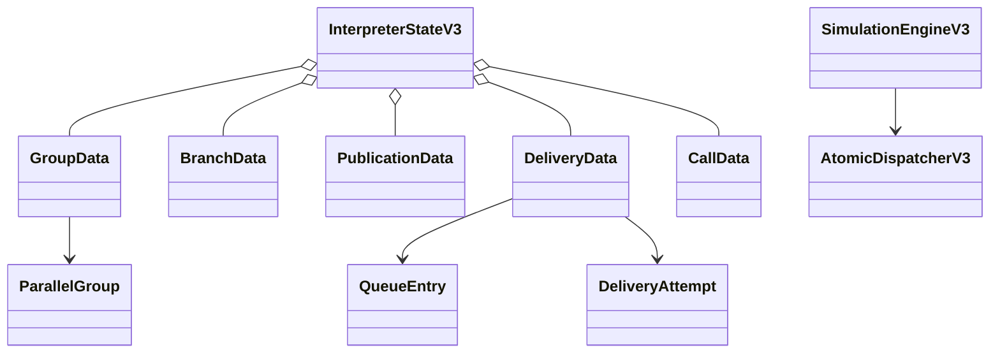
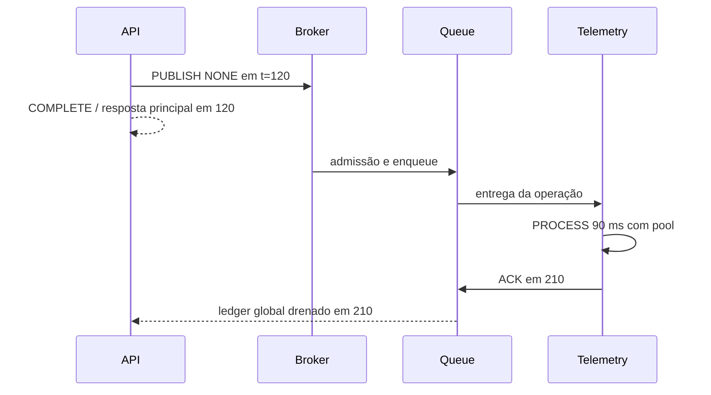

# BE-V3-08 — Branches e mensageria executáveis

Referências: ADR-v0.3.md (020, 022, 025, 026), nove steps e 32 payloads do OpenAPI.

FORK cria ativações independentes por branch, com vínculos persistidos no CONTROL.
JOIN coordena ALL/ANY/FIRST_SUCCESS/QUORUM, resultados terminais, impossibilidade e
prazo; desempates usam o scheduler. CONTINUE/IGNORE_RESULTS deixam o trabalho restante
ser contabilizado globalmente, sem reabrir o resultado principal. CANCEL_REQUEST envia
cancelamento às branches restantes. FORKs aninhados e pools compartilhados executam.

PUBLISH separa NONE, BROKER_ACK e CONSUMER_ACK. Broker admite fan-out atomicamente,
valida disponibilidade/capacidade e reserva entradas de fila. Rejeição gera uma entrada
DISCARDED de auditoria, sem ocupar capacidade ou emitir fato de enqueue; isso mantém
queueEntryId do detalhe de trace exigido pelo contrato sem usar um ID de publication.
Queue possui FIFO por ordinal persistido, limite, concorrência de consumidor, ACK,
prazo de ACK, TTL, redelivery/backoff e limite de tentativas com DEAD_LETTERED. Esse
estado não encaminha fisicamente a uma DLQ externa. Consumidor executa operação real
no mesmo motor (incluindo Telemetry); nenhum tráfego de rede é produzido.

## Propriedades concretas do catálogo

- TOPIC: queueIds LIST de REFERENCE/MESSAGE_QUEUE; acceptanceMs INTEGER opcional.
- MESSAGE_QUEUE: capacity, ttlMs, consumerEndpointId REFERENCE/ENDPOINT,
  consumerOperationId REFERENCE/OPERATION opcional, consumerConcurrency,
  deliveryLatencyMs, ackDelayMs, ackTimeoutMs, maxDeliveryAttempts, redeliveryDelayMs.
  Padrões: capacity 100, consumerConcurrency 1, ackTimeoutMs 1000,
  maxDeliveryAttempts 3; demais durações zero ou TTL ausente.
- PROCESSING_POOL: waitTimeoutMs opcional, além de capacity e available.
- POLICY_INSTANCE: timeoutMs, attemptTimeoutMs, maxAttempts, retryDelayMs.
  Estados nativos ENABLED/DISABLED podem vir do estado inicial ou evento de policy.
  Retries RPC criam attempts/ativações novos e preservam o histórico anterior.

As convenções são decisões explícitas sobre os identificadores/propriedades abertos
no YAML. Condições incompatíveis serão reportadas pelos validadores do card 10 antes
que o endpoint execute o motor. As operações nativas do Database e Telemetry usam
processamento virtual configurado e o primeiro pool próprio por ID, quando declarado.

ACK tardio, resposta de tentativa antiga e chegada duplicada não reabrem entidades.
Claims protegem start, send/arrival, response, policy e resource change. ReadView agora
expõe claims imutáveis; não há estado externo ao commit. Evento obsoleto vira Ignore.
Timeout de publicação não cancela mensagem já aceita; trabalho global continua. Timeout
de operação cancela CALLs aguardados e grupos ainda não liberados, liberando leases.

## Verificação real

JDK 25.0.4.1, mvnw.cmd -B clean verify: BUILD SUCCESS, 201 core + 97 API = 298
casos sem failures/errors/skipped. Vinte e um casos novos cobrem os seis componentes
no CE-REF-01 (120/210 ms), três modos de PUBLISH, quatro políticas JOIN, quórum e
cancelamento, FORK aninhado (25 ms), FIFO em pool compartilhado, fan-out/ACK de todos
os destinos, timeout de recurso, mensagens iniciais, redelivery/dead letter, TTL/ACK
empatado, fila cheia, retries RPC, policy inicial/evento, duplicação, restart e replay.
As regressões v1/v2/RF-044 continuam passando. Todos os 32 tipos têm case explícito
no dispatch; o switch sealed é exaustivo e não mascara tipos ausentes com no-op.

Log local: C:/Users/valde/Documents/ChatGPT/ArchLab/logs/be-v3-08-verify.log.
HTTP, projeção de métricas/resultado, golden fixtures e integração frontend seguem em
09–12. O checkpoint Java preserva o runtime real; formato FULL_RUNTIME HTTP não é
alegado como implementado por este card.
