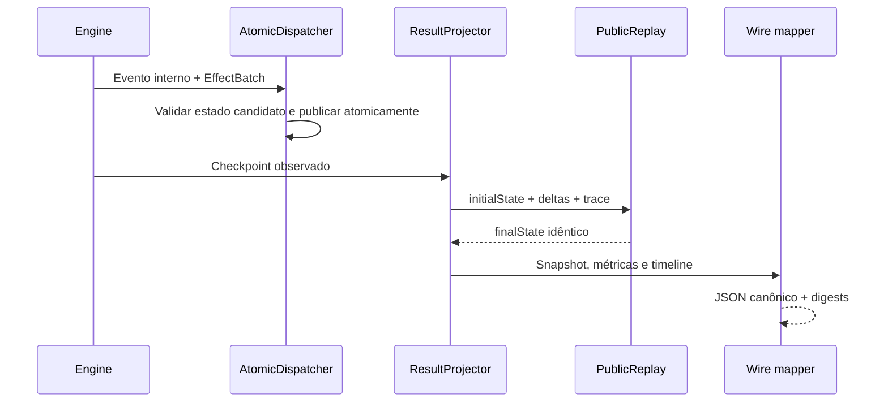

# BE-V3-09 — resultados verificáveis

O projector integra intervalos observados do journal, sem somar espera inclusiva à latência. O fixture docs/examples/v3/ce-ref-01-request.json executa Client → API → Database e API → Broker → Queue → Telemetry: resposta principal 120 ms, conclusão global 210 ms, processamento Telemetry 90 ms. No horizonte de 150 ms, contabiliza somente 30 ms observados de Telemetry e mantém os intervalos abertos.

PublicSnapshotV3 contém oito famílias públicas, com IDs e versões do runtime. PublicReplayV3 exige sequência e tempo crescentes, IDs de delta únicos, fato de origem no mesmo instante, before exato, versões consecutivas e referências finais consistentes. ResultProjectorV3 verifica replay(initialState,deltas)==finalState antes de produzir qualquer resultado. Os seis testes novos cobrem reconstrução, rejeição de corrupção, horizonte, JOIN e fingerprint de entrada; SimulationResultV3Test gera os JSON reais e comprova determinismo e digest.

SimulationResponseMapperV3 produz o contrato HTTP, com SHA-256 de JSON canônico (chaves recursivamente ordenadas, UTF-8, sem espaços); normalizedResultDigest omite integrity. A validação independente Ajv 2020 passou para request, execução completa, repetição e horizonte. A ocupação do trace de recursos usa Long, corrigindo o gerador para nullable integer.

O checkpoint interno inclui controle, agenda, claims, contadores, estado aleatório e fingerprint integral da entrada. A retomada recusa uma entrada diferente. AtomicDispatcherV3 também verifica replay do journal interno; isso é separado do escopo público exportado. O endpoint exportará PUBLIC_SNAPSHOT; não exporta FULL_RUNTIME e declara playbackReconstructible=false e fullRuntimeSnapshotReconstructible=false. O core suporta retomada interna, mas a representação HTTP não a promete. Os três criticalPaths declaram explicitamente unavailableReason=CAUSAL_CRITICAL_PATH_NOT_COMPUTED, conforme alternativa permitida pelo OpenAPI; nenhuma duração crítica é inventada.

Métricas: durações principal/global/observação/background; contagem por componente e interação; processamento, espera inclusiva, transporte; recursos (aquisição, rejeição, timeout, espera, integral de ocupação, pico); grupos com início, liberação do JOIN e término de todas as branches separados. Timeline mantém vínculos parent e fatos de início/término.

Validação local: Java 25; Maven clean verify, core 207 + API 98 = 305 testes, zero falhas/erros/skip. Nenhuma dependência JSON/Spring no core.

