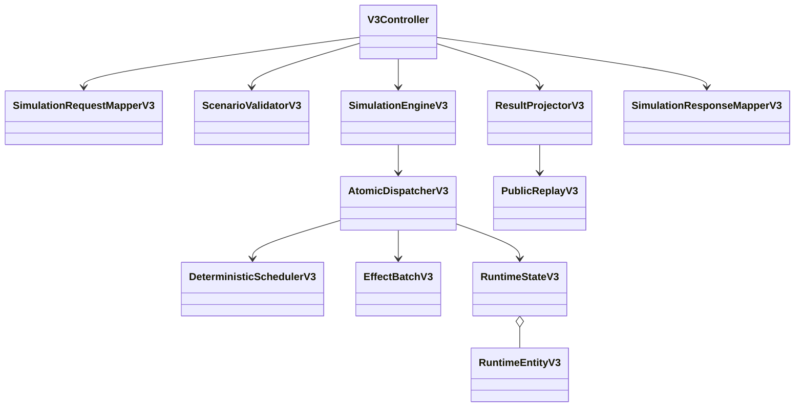

# BE-V3-12 — revisão arquitetural e integração

## Fronteiras e decisões

O core é Java 25 puro, sem Spring/Jackson/relógio de parede. Cada simulação tem estado imutável e agenda próprios; os adaptadores HTTP são stateless. Maven mantém dois módulos: archlab-simulation-core e archlab-api (Spring Boot4). O catálogo inicial limita componentes, capacidades, recursos, protocolos, propriedades e limites numéricos; extensibilidade estrutural do YAML não significa suporte automático a tipos novos.

O dispatcher decide sobre uma ReadView imutável, aplica efeitos em estado candidato, verifica invariantes e só então publica um Snapshot completo. Estado, agenda, claims, IDs, sequência, trace, deltas e PRNG avançam juntos. Uma falha de guard/efeito não consome o evento original. Entidades têm identidade vitalícia e versões consecutivas; nenhuma lease atravessa CALL/JOIN. O scheduler ordena tempo virtual, estágio causal, rodada, fase, sequência e ID; entregas no deadline prevalecem sobre timeout. Não há consulta ao relógio do sistema.



## Sequência CE-REF-01, com seis componentes

```mermaid
sequenceDiagram
  participant C as Client
  participant A as API
  participant D as Database
  participant B as Broker
  participant Q as Queue
  participant T as Telemetry
  C->>A: t=0 request
  A->>A: PROCESS 20ms
  A->>D: CALL request 10ms (t=30)
  D->>D: Pool PROCESS 40ms (t=70)
  D-->>A: Response 10ms (t=80)
  A->>A: PROCESS 40ms (t=120)
  A->>B: PUBLISH NONE
  A-->>C: Principal RESPONDED t=120
  B->>Q: Aceitação e enqueue no t=120
  Q->>T: Delivery
  T->>T: Pool PROCESS 90ms
  T-->>Q: Consumer ACK t=210
  Note over C,T: Global COMPLETED t=210; background=90ms
```

## Concorrência e publicação atômica

```mermaid
sequenceDiagram
  participant S as Scheduler
  participant E as Interpreter
  participant D as Dispatcher
  participant R as Runtime candidato
  S->>E: Evento ordenado
  E-->>D: Apply EffectBatch ou Ignore explícito
  D->>R: Guards, efeitos, agenda e deltas
  R->>R: Versões, referências, claims, recursos
  alt Tudo consistente
    R-->>D: Snapshot imutável
    D-->>S: Publicar estado e agenda juntos
  else Falha
    D-->>D: Conservar snapshot e evento originais
  end
  Note over E,R: FORK cria ativação por branch; JOIN libera conforme política
  Note over E,R: Branches CONTINUE mantêm trabalho global após resposta principal
```

## Rastreabilidade do ADR consolidado

| ADR editorial | Execução e evidência |
|---|---|
| 018 isolamento | Pacotes v3 isolados, CoreIndependenceTest, regressões v1/v2 |
| 019 tipagem | ArchitectureV3, PropertyValueV3, TypeCatalogV3, validators e 6 componentes |
| 020 planos | Nove tipos sealed, validação de regiões/limites, ExecutionMatrixV3Test |
| 021 relógio | DeterministicSchedulerV3 + seed explícita, deadline/zero/horizonte |
| 022 estado | RuntimeEntityV3, StateTransitionsV3, RuntimeStateV3 invariantes |
| 023 eventos | 32 payloads sealed, codec inválidos/roundtrip, 32 despachos reais |
| 024 atomicidade | EffectBatchV3 + AtomicDispatcherV3, guards/rollback/replay |
| 025 fluxos | Interpreter síncrono, FORK/JOIN, fanout, ACK, TTL, retry, recuperação |
| 026 resultado | Principal120/global210 separados, horizonte sem conclusão inventada |
| 027 replay | Checkpoint integral Java, journal interno, PUBLIC_SNAPSHOT e digests |
| 028 HTTP | Quatro endpoints, validações200, inválido422, falha simulada200, ProblemV3 |
| 029 qualidade | PR por card, CI Java25, goldens, integração real e tipos TS gerados |

Os números/títulos são a organização editorial de docs/architecture/ADR-v0.3.md, conforme a nota do próprio documento; esta revisão não inventa os textos históricos ausentes. Escolhas adicionais do catálogo estão nos documentos de cada card.

## Contrato frontend e portões

ArchlabV3Client importa paths/components gerados de schema-v3.d.ts e expõe quatro métodos. valid:false e falha simulada200 permanecem resultados de domínio; HTTP não2xx produz ArchlabV3HttpError com Problem/violations e status. O cliente aceita AbortSignal. Os dez testes novos do adaptador cobrem rotas, payloads e erros; são complementados por integração Node contra API Java real, sem mock de core. A UI existente continua consumindo seu cliente versionado; este card entrega integração por contrato, sem redesenhar o editor.

npm run typegen gera schemas v1/v2/v3 em frontend/src/api/generated (artefatos ignorados e reproduzidos no pretest/prebuild, como as versões anteriores). npm run lint, npm test (18 arquivos/86 testes) e npm run build passaram. Redocly CLI1 lint do YAML passou, com três avisos já explicitamente ignorados na configuração. O script integration-v3.mjs comprova quatro endpoints, determinismo, CE-REF120/210/90, horizonte150,422 e falha200. integration.mjs legado preserva260/170/sete atividades e validações.

Backend CI passa a executar também os dois scripts de integração contra jar real em porta isolada, com encerramento do processo criado. Frontend CI observa os três contratos; OpenAPI CI observa o cliente/pacote v3. Backend mantém327 testes JUnit e validação Ajv2020 de51 artefatos/fixtures reais. A aprovação técnica exige esses checks verdes antes do merge.

## Limitações explícitas do perfil entregue

O motor simula infraestrutura e protocolos; não conecta bancos/brokers externos. Checkpoint Java é integral e testado, mas HTTP exporta somente PUBLIC_SNAPSHOT: playbackReconstructible/fullRuntimeSnapshotReconstructible=false. Critical paths usam a alternativa contratual unavailableReason=CAUSAL_CRITICAL_PATH_NOT_COMPUTED, durationMs=null e activityIds vazios. Estes campos não são usados para anunciar recursos calculados que não existem. Não há corte/truncamento de trace nesse perfil; parada por horizonte/limite preserva COMPLETE_UNTIL_STOP e trabalho pendente.

Nada foi integrado em main e nenhuma release foi criada. Relatório de todos os cards: [backend-v0.3-report.md](backend-v0.3-report.md).
