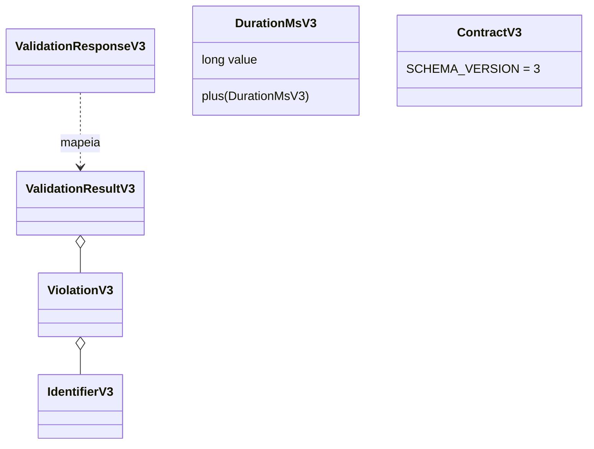
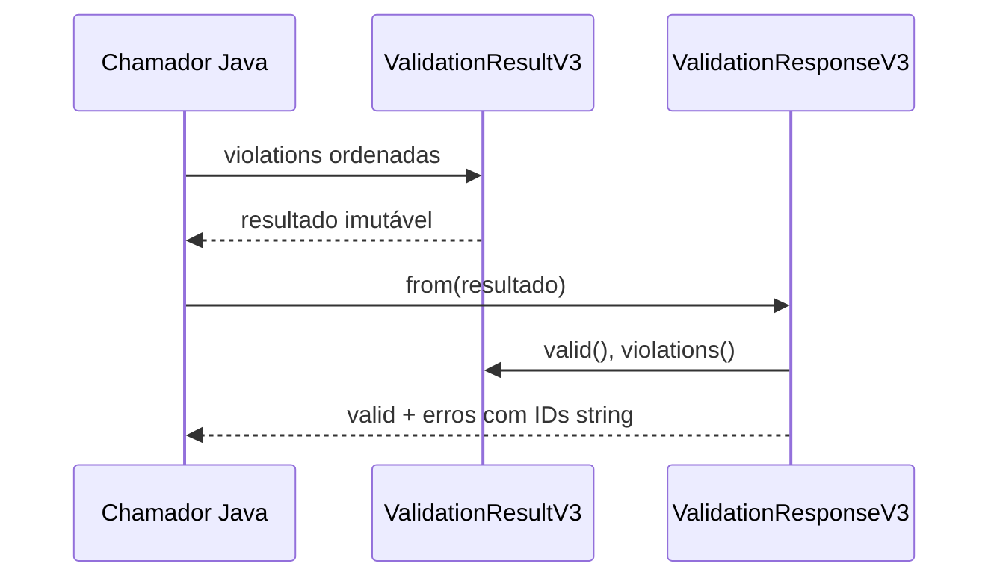

# Backend v0.3 — plano e evidências

Base inicial: develop f7503b7. Cards BE-V3-01 a BE-V3-12 consultados em 2026-11-02.
Fonte de estrutura: docs/api/openapi-v3.yaml. Autorização atual permite decisões técnicas,
PRs e merges em develop após verificações; main e releases fora do escopo.

## Dependências e portões de aceite

| Card | Dependências | Portão obrigatório |
|---|---|---|
| 01 | OpenAPI | tipos estáveis, core Java puro, build e regressão v1/v2 |
| 02 | 01 | seis componentes tipados, recursos/operations/capabilities, erros determinísticos |
| 03 | 02 | nove steps, referências, ciclos, alcance, limites e quórum |
| 04 | 01 | fases 0/10/20/30/40, causalidade, seed, zero, horizonte e deadlines |
| 05 | 02,04 | 32 payloads, estados e transições legais, ausência de mutação antecipada |
| 06 | 04,05 | validação de efeitos, atomicidade, claims e falhas sem estado parcial |
| 07 | 03,06 | PROCESS/CALL/CONDITION/DELAY/COMPLETE/FAIL, retorno e timeout |
| 08 | 07 | FORK/JOIN/quórum, Broker/Queue/PUBLISH, ack, retry e background |
| 09 | 06,07,08 | journal e replay real, snapshots, métricas, CE-REF-01 120/210 ms |
| 10 | 02,03,09 | quatro endpoints, 200/422/problem details, v1/v2 preservados |
| 11 | 10 | integração sem mock de core, golden fixtures, verify e determinismo |
| 12 | 11 | UML/sequência reais, CI, typegen/frontend build e rastreabilidade |

Ordem: 01 → 02 → 03 → 04 → 05 → 06 → 07 → 08 → 09 → 10 → 11 → 12.
01 também libera 04 independentemente do modelo. Cada card requer PR para develop.

## Aceite por componente

| Componente | Evidência exigida |
|---|---|
| Client | iniciar operação principal, receber resposta, duração principal e timeout |
| API | plano, recursos, chamada aninhada, WAITING/RESPONDED, erro e cancelamento |
| Database | operação tipada, aquisição/liberação, processamento e retorno correlacionado |
| Broker | aceitação/roteamento, falha de entrega, fan-out conforme capacidades |
| Queue | FIFO/capacidade, consumidores, ack, TTL, redelivery e reentrância |
| Telemetry | coleta/métricas/trace, trabalho global independente, replay reconstruível |

Nenhuma dessas evidências funcionais é fornecida pelo bootstrap.

## Fronteira implementada no card 01

Identificadores preservados sem trim; comprimento por pontos de código Unicode (1..128).
Durações virtuais long não negativas, soma com overflow explícito. Versão de schema 3,
erros com severidade e IDs imutáveis. Validade derivada da presença de ERROR.
API converte IDs de domínio em strings, sem dependência reversa no core.
Não foram adicionados controllers nesta fundação.

## Lacunas de fontes

O repositório contém citações, mas não o texto integral de ADR-018..029,
EP/DM/CM/CE/EV/SCH/EC/DT/RS-V3-001. A conversa referenciada recuperada contém
o encaminhamento e os cards, sem essas especificações. O YAML define os formatos,
mas não substitui a semântica normativa completa de scheduler, handlers e claims.
Não afirmar conformidade com essas especificações sem obter suas fontes.
Os registros API-V3-007/009/010 têm estados históricos; a autorização atual e
as validações estáticas posteriores permitem iniciar a implementação.

## Estado

01: implementação em verificação. 02–12: pendentes. Resultados de testes, commit e PR
devem ser registrados após execução real. Nenhum card funcional considerado concluído
apenas por conformidade estrutural do YAML.

## Verificação BE-V3-01

- JDK Oracle 25.0.4.1 selecionado explicitamente via JAVA_HOME.
- Comando: backend/mvnw.cmd -B clean verify (executado no diretório backend).
- Resultado final: BUILD SUCCESS; core 106 testes, API 23; zero failures/errors/skipped.
- Inclui CoreIndependenceTest, V1PublicContractRegressionTest e V2PublicContractTest.
- Cinco testes novos: limites de IDs Unicode, espaços ECMAScript, duração negativa e
  overflow, cópias defensivas, severidade/validade, schemaVersion e mapper API.
- Revisão: fontes v1/v2 e seus contratos não alterados; dependências Maven não alteradas.
- Log local completo: C:/Users/valde/Documents/ChatGPT/ArchLab/logs/be-v3-01-verify.log.
- Trade-off: value objects no core, strings no DTO HTTP, evitando acoplar serialização
  ao domínio. Compatibilidade semântica de motor v3 ainda não implementada.
- BE-V3-01: critérios de bootstrap verificados. BE-V3-02 a BE-V3-12 permanecem pendentes.

## Retomada após ADR consolidado

Em 2026-11-02, o usuário indicou docs/architecture/ADR-v0.3.md, incorporado em develop
3df2b74 via PR #51. O trabalho foi retomado usando esse documento e o OpenAPI, com
as escolhas de catálogo registradas em BE-V3-02-domain.md. O inventário de ausência
acima descreve a primeira execução; não é bloqueio atual. BE-V3-01 integrado por PR #50.
BE-V3-02: domínio e decoder verificados com 168 testes; evidências no documento específico.
BE-V3-03..12: pendentes; tipos dos nove steps preparados, sem execução implementada.

## Estado após implementação da fundação e dispatcher

BE-V3-01..05 integrados em develop (PRs #50, #52, #53, #54, #55). BE-V3-06 tem
implementação local verificada com 265 testes e segue para PR/CI. Evidências por card
em BE-V3-02-domain.md, BE-V3-03-execution-plans.md, BE-V3-04-scheduler.md,
BE-V3-05-runtime-events.md e BE-V3-06-atomic-dispatch.md.
BE-V3-07..12 continuam pendentes: não há interpretador completo, mensageria executável,
CE-REF-01, métricas/resultados completos, endpoints v3 ou aceite integrado final.
