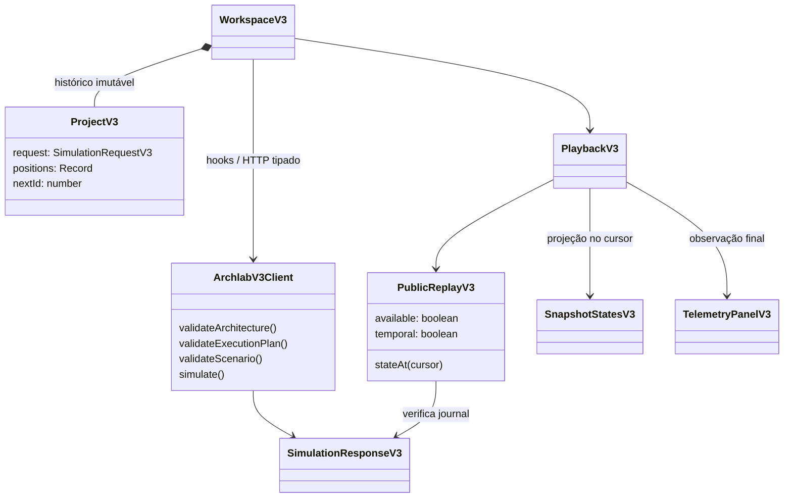
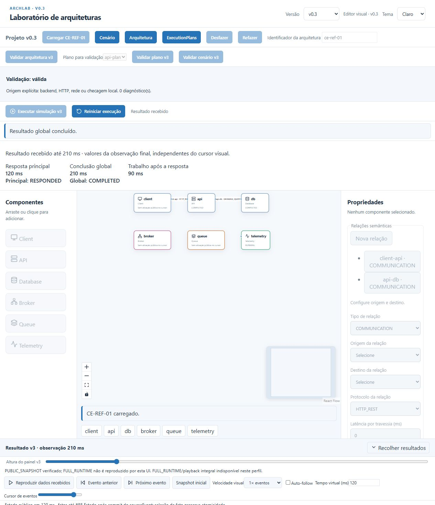
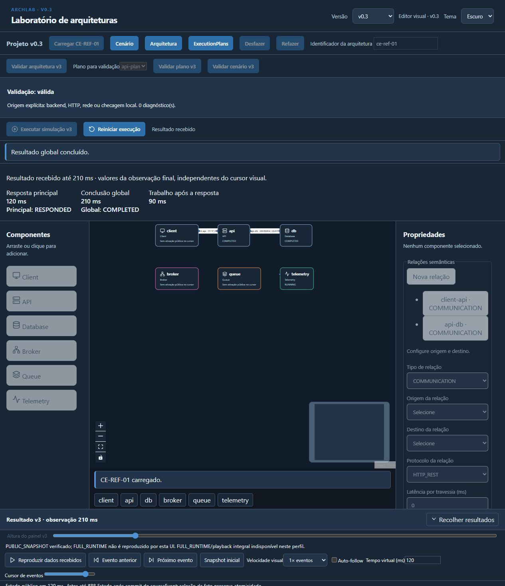

# ArchLab v0.3 — frontend, fluxos e verificação

Implementação React/TypeScript/Vite isolada em `frontend/src/features/v3`, integrada aos quatro endpoints do [OpenAPI v3](../api/openapi-v3.yaml). A [ADR-v0.3](../architecture/ADR-v0.3.md) permanece a referência arquitetural. O editor v0.1/v0.2 continua disponível no seletor **Versão**; a v3 abre em `http://localhost:5173/#v3`.

## Executar

Requisitos: Node.js 22/npm, JDK 25 e Maven Wrapper incluído. Spring Boot 4 e o core Java puro já pertencem ao backend. Não há dependência Python, Playwright ou novo framework no frontend.

No PowerShell, a partir da raiz do repositório:

```powershell
$env:JAVA_HOME='C:\Program Files\Java\jdk-25.0.4.1' # ajuste ao JDK 25 instalado
cd backend
.\mvnw.cmd clean verify
& "$env:JAVA_HOME\bin\java.exe" -jar archlab-api/target/archlab-api-0.1.0-SNAPSHOT.jar
```

Em outro terminal:

```powershell
cd frontend
npm install
npm run dev
```

Vite encaminha `/api` para `http://localhost:8080`. Em outra origem, configure `VITE_API_BASE_URL` antes de iniciar/buildar. `ARCHLAB_API_URL` é a variável dos scripts de integração, não a configuração do navegador.

## Modelar e executar

1. Escolha **v0.3**. Adicione Client, API, Database, Broker, Queue e Telemetry pela sidebar ou arraste ao canvas. Clique no nó ou na lista de componentes para selecionar. Pan/zoom e Fit View ajudam em diagramas maiores.
2. No painel direito, configure nome, propriedades tipadas e recursos compatíveis com o tipo. Estados iniciais são configurados no proprietário. Renomear não altera IDs nem vínculos. Exclusão de entidades referenciadas é bloqueada com orientação. Desfazer/refazer conserva IDs estáveis no histórico.
3. Configure endpoints, operações nativas ou vinculadas a plano e relações semânticas. Conexões de comunicação usam endpoints reais, direção e protocolo; relações estruturais não se tornam chamadas simuladas.
4. Em **ExecutionPlans**, selecione plano, entrada e limites. Adicione `PROCESS`, `CALL`, `PUBLISH`, `CONDITION`, `FORK`, `JOIN`, `DELAY`, `COMPLETE`, `FAIL`; configure destinos/outcomes e referências. As condições são dados estruturados, nunca código. FORK define branches/entrada/JOIN; JOIN configura política, branches requeridas, quórum quando aplicável, deadline e política do trabalho restante.
5. Em **Cenário**, escolha Client, operação/conexão de entrada, parâmetros tipados, seed e modo de conclusão. Horizonte exige `horizonAtMs`. Use **Carregar CE-REF-01** para o exemplo aprovado.
6. Valide arquitetura, plano ou cenário. **Executar simulação v3** realiza preflight pelos três validadores e envia exatamente o projeto validado. Diagnósticos identificam origem e localização; clique para navegar ao componente/plano/step. Um diagnóstico antigo é explicitamente marcado como desatualizado.
7. Durante a solicitação ou inspeção de um resultado, edição fica bloqueada. **Reiniciar execução** libera o rascunho preservado. **Interromper espera** aborta somente a espera HTTP do navegador; não cancela trabalho no Java.

As validações locais orientam o formulário; o backend decide a validade semântica completa. Os seis componentes refletem o TypeCatalogV3 real e seus recursos/capacidades, sem simulação paralela na UI.

## Analisar resultados

O resumo mantém **Resposta principal**, **Conclusão global** e **Trabalho após a resposta** distintos. CE-REF-01 retorna **120 ms**, **210 ms** e **90 ms**, respectivamente. Esses valores pertencem à observação final recebida e não mudam ao mover o cursor.

- **Timeline**: atividades/intervalos paralelos, relações parent, eventos ordenados por timestamp e `sequence` do backend. Exibe até 40 atividades e 50 fatos por página. O estado de término da atividade é rotulado como recebido, não como estado atual do cursor.
- **States**: oito famílias públicas — ativações, interações, tentativas de chamada, grupos paralelos, recursos, entradas de fila, publicações e tentativas de entrega. Filtro por ID/estado e paginação 25. O painel e o canvas acompanham o mesmo snapshot público do cursor.
- **Details**: fato selecionado, contexto e dados discriminados originais. Campos textuais são renderizados pelo React; nenhum HTML/código retornado é executado.
- **Resultados**: principal/global, contadores, pendências, métricas por componente/interação/recurso/fila/grupo, caminhos críticos, trace, metadados e integridade. Trabalho agregado pode sobrepor intervalos; não equivale à duração do relógio virtual. Valores nulos são **Não disponível**, preservando zero quando efetivamente retornado.

Reproduzir/pausar/velocidade são controles da navegação visual sobre dados já recebidos. Selecionar manualmente um fato suspende reprodução e auto-follow. ArrowLeft/ArrowRight, Home e End navegam nas abas com foco único; todos os formulários têm rótulos e foco visível. O painel inferior é recolhível e ajustável. Layout responsivo, nomes longos, claro/escuro e reduced-motion usam os padrões existentes.

## Decisões e limites do contrato

| Tema | Decisão implementada e evidência |
| --- | --- |
| APIs | Apenas POST `architectures/validate`, `execution-plans/validate`, `scenarios/validate`, `simulations`, sob `/api/v3`. Nenhum endpoint incremental, pause/resume ou cancel foi criado. |
| Erros | Validação200 `valid:false` e simulação422 preservam violações. Erro HTTP/rede/resposta incompatível é distinto de falha simulada em resultado200. |
| Principal/global | `IN_PROGRESS` pertence ao principal; o global recebido usa os estados definidos no seu próprio schema. Horizonte/limite não são conclusão. Null não vira zero. |
| Journal | O perfil HTTP atual anuncia `PUBLIC_SNAPSHOT`; `playbackReconstructible` e `fullRuntimeSnapshotReconstructible` são false. Reconstrução pública não prova reexecução do motor. |
| Atomicidade | Deltas validam ID, lifetime, before e versões; o resultado reconstruído deve igualar `finalState`. Fatos contíguos do mesmo `sourceEventId`/tempo são projetados após o commit lógico inteiro. O cursor informa a sequência efetiva desse grupo, preservando efeitos atômicos. |
| Dados insuficientes | Journal ausente/truncado ou origens sem ordenação temporal sustentada desabilitam navegação reconstruída; o snapshot final permanece inspecionável com aviso. Não se inventam estados. |
| Version opcional | Schemas estáticos permitem omitir `version`; entidades de journal reconstruível devem possuir versão. Adaptador e replay respeitam essa distinção. |
| Estados internos | Snapshots públicos não exportam cursores internos de branch, disponibilidade interna de componente nem deadlines individuais. A UI mostra IDs/estados públicos e fatos efetivamente recebidos, sem deduzir dados ausentes. |
| Métricas | São finais até a parada observada. CriticalPaths indisponíveis mostram o motivo retornado. O contrato não oferece coleção separada de warnings de simulação: warnings dos validadores e fatos do trace ficam nos painéis correspondentes. |
| Integridade | Digests são informados pelo servidor; a UI verifica consistência estrutural/journal, sem alegar autenticação criptográfica dos digests. |
| Compatibilidade | Workspaces montados preservam rascunhos independentes. Clientes/contracts/modelos legados e RF-044 permanecem isolados. Estilos de evolução são restritos à v3. |
| Tipos e limites JS | Tipos derivam do YAML. Números inseguros são rejeitados; DECIMAL tipado mantém representação textual. Nenhuma função Java de scheduler/dispatch/domínio foi reimplementada no frontend. |

Não foi necessário contrariar ADRs aprovadas. As distinções acima resolvem diferenças entre a abrangência do runtime interno e a projeção realmente disponível no HTTP.

## Rastreabilidade

| Card | Entrega / referência ADR | PR e commits locais |
| --- | --- | --- |
| FE-V3-01 | Contrato/tipos/projeto isolado —018/028 | [63](https://github.com/ValdemirPraxedes/ArchLab/pull/63), `a350546` |
| FE-V3-02 | Catálogo/canvas seis tipos —019 | [64](https://github.com/ValdemirPraxedes/ArchLab/pull/64), `f63cd90` |
| FE-V3-03 | Propriedades/recursos/estados iniciais —019/022 | [65](https://github.com/ValdemirPraxedes/ArchLab/pull/65), `b75463a`, `888d6f3`, `ca25212` |
| FE-V3-04 | Endpoints/operações/relações —019/025 | [66](https://github.com/ValdemirPraxedes/ArchLab/pull/66), `47f398b` |
| FE-V3-05 | Nove steps e transições —020/025 | [67](https://github.com/ValdemirPraxedes/ArchLab/pull/67), `7346810` |
| FE-V3-06 | Cenário e controles —021/026/028 | [68](https://github.com/ValdemirPraxedes/ArchLab/pull/68), `5f88c50` |
| FE-V3-07 | Validação integrada/diagnósticos —019/020/028 | [69](https://github.com/ValdemirPraxedes/ArchLab/pull/69), `e9ceb34` |
| FE-V3-08 | Cliente/adapter/execução real —026/027/028 | [70](https://github.com/ValdemirPraxedes/ArchLab/pull/70), `e6e7bce` |
| FE-V3-09 | Replay público atômico —021/024/027 | [71](https://github.com/ValdemirPraxedes/ArchLab/pull/71), `bc03459` |
| FE-V3-10 | Oito famílias e branches/filas —022/025/027 | [72](https://github.com/ValdemirPraxedes/ArchLab/pull/72), `fa19ec8` |
| FE-V3-11 | Principal/global e telemetria —026/027 | [73](https://github.com/ValdemirPraxedes/ArchLab/pull/73), `c2bd90b` |
| FE-V3-12 | UX/acessibilidade/temas —018/029 | [73](https://github.com/ValdemirPraxedes/ArchLab/pull/73), `4c8be91` |
| FE-V3-13 | Matriz real/goldens/regressão —018/029 | [74](https://github.com/ValdemirPraxedes/ArchLab/pull/74), `65fffa6` |
| FE-V3-14 | Guia/diagramas/evidências/revisão —029 | PR de documentação desta entrega; aceite registrado no Trello após checks/merge |

Commits publicados pelo conector têm metadados/SHA diferentes dos commits locais; suas árvores Git são verificadas como idênticas antes de abrir cada PR. PRs e merges para `develop` são a referência remota. Nenhuma release/tag ou alteração em `main` pertence a esta missão.

## Arquitetura da UI (UML)



## Sequência HTTP e inspeção

```mermaid
sequenceDiagram
  actor U as Usuário
  participant UI as Workspace v3
  participant API as HTTP v3
  participant Java as Motor Java
  participant R as Replay público UI
  U->>UI: Executar
  UI->>UI: Clonar request / bloquear edição
  par Preflight do mesmo request
    UI->>API: POST architectures/validate
    UI->>API: POST execution-plans/validate (cada plano)
    UI->>API: POST scenarios/validate
  end
  API-->>UI: valid e violações
  alt Preflight válido
    UI->>API: POST simulations
    API->>Java: Executar até condição de parada
    Java-->>API: Principal + global + trace + snapshots + deltas + métricas
    API-->>UI: HTTP200 resultado (inclusive falha simulada)
    UI->>UI: Adaptar e verificar contrato/correlação
    UI->>R: Verificar versões/before e igualdade final
    U->>UI: Selecionar120 ms ou fato
    UI->>R: stateAt(cursor)
    R-->>UI: Snapshot após commit atômico
    UI-->>U: Canvas/States no cursor; métricas finais rotuladas
  else Preflight inválido / erro HTTP
    UI-->>U: Diagnósticos localizáveis / erro explícito
  end
```

## Sequência do cenário CE-REF-01

```mermaid
sequenceDiagram
  participant C as Client
  participant A as API
  participant D as Database
  participant B as Broker
  participant Q as Queue
  participant T as Telemetry
  C->>A: Operação raiz em0 ms
  A->>A: PROCESS20 ms
  A->>D: CALL (10 ms transporte)
  D->>D: PROCESS40 ms (30..70)
  D-->>A: Resposta (10 ms transporte, chega80 ms)
  A->>A: PROCESS40 ms (80..120)
  A->>B: PUBLISH awaitMode NONE em120 ms
  A-->>C: Resposta principal120 ms
  B->>Q: Publicação aceita / entrega
  Q->>T: Operação assíncrona120 ms
  T->>T: PROCESS90 ms
  T-->>Q: Resultado e ACK210 ms
  Note over C,T: Principal120 ms ≠ global210 ms; background90 ms
```

## Testes reproduzíveis e evidências

Com backend ativo:

```powershell
cd frontend
npm run lint
npm test
npm run build
$env:ARCHLAB_API_URL='http://localhost:8080'
npm run test:integration
npm run test:integration:v3
npm run test:integration:v3-client
```

`typegen` gera os três contratos TypeScript, incluindo `schema-v3.d.ts`; `pretest` e `prebuild` executam essa geração. Arquivos gerados são ignorados no Git. O build inclui typecheck da entrada de integração SSR. O runner usa a API já instalada do Vite para empacotar os clientes TypeScript reais em Node 22; não usa uma cópia JavaScript de seu comportamento.

Evidências executadas na entrega: lint sem warnings, build, **204 testes em 39 arquivos**, integração HTTP v1, cliente tipado v2/v3, **64 artefatos/fixtures OpenAPI/Ajv**. Verificação local final do backend: **327 testes, zero falhas/erros/skips**, Java 25 `clean verify` aprovado. BackendCI também executa Java 25 `clean verify`, validação Draft2020-12 e integração real. FrontendCI executa lint/test/build. Fixtures são resultados do Java, nunca regeneradas pela implementação da UI.

| Cenário real | Evidência esperada e verificada |
| --- | --- |
| Legado v1 |260 ms; WAITING170 ms; transições e duração zero preservadas |
| Legado v2/RF-044 |57 ms; override102 ms; override zero47 ms; retorno aos defaults57 ms; REST500 ilustrativo não falha a execução; SOAP/DB preservados |
| CE-REF-01 |Principal120/global210/background90; repetição idêntica; journal reproduz finalState |
| Cursor120 |Telemetry RUNNING; fila IN_DELIVERY, sem antecipar ACK final |
| FORK/JOIN ANY CONTINUE |Principal30/global80; JOIN_SATISFIED em30 e grupo COMPLETED em80 |
| Horizonte150 |Principal respondido, global HORIZON_REACHED; conclusão nula |
| Horizonte10 |Principal IN_PROGRESS, tempos de resposta/término nulos e pendências reais |
| Loop DELAY zero limitado |LIMIT_REACHED determinístico, sem loop infinito da UI |
| CONDITION |True mantém120/210; false executa FAIL, principal FAILED em HTTP200 válido |
| Inválido |Validator200 valid:false; simulação422 preserva violações |
| Insuficiência/corrupção |Journal ausente/truncado não habilita replay; versões/before/IDs/final divergentes são rejeitados |
| UI |E2E navegador conectado com Java real, teclado, claro/escuro,390px, rascunhos v2/v3 independentes; trace2000 paginado e texto inseguro escapado em RTL |

Não existe infraestrutura Playwright/E2E instalada no repositório. A verificação de navegador foi realizada com automação conectada; os scripts HTTP e testes Vitest/RTL são reproduzíveis na CI. Não se declara um comando Playwright inexistente como aprovado.

Screenshots reais capturados durante a verificação (não mockups):





## Revisão técnica da entrega

Verificados isolamento v1/v2/RF-044, tipos derivados, wire request sem metadados de UI, validação do mesmo snapshot, proteção de respostas tardias/abort, distinção erro HTTP/falha simulada, projeção pública atômica, limites/paginação e ausência de estados inventados. As limitações conhecidas são capacidades não exportadas pelo contrato, descritas acima; não foram marcadas como implementadas.

Persistência em servidor, colaboração, execução incremental e replay FULL_RUNTIME não fazem parte das APIs desta entrega. Rascunhos ficam em memória enquanto a página permanece aberta; não há promessa de recuperação após recarregar. A validação final do usuário ocorre após todos os cards/checks/merges, registrada no relatório de encerramento.
